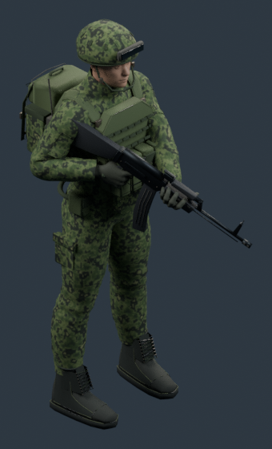

# Russian infantry base — Autonomous Warfare

One reusable Russian faction character, with a separate replaceable AK-74M. No role-specific full-body variants and no animation set.

| Deliverable | Path |
| --- | --- |
| Packed editable A-pose | [Russian_Infantry.blend](source/Russian_Infantry.blend) |
| Procedural, pre-bake geometry | [Russian_Infantry_Geometry.blend](source/Russian_Infantry_Geometry.blend) |
| Character only | [GLB](models/Russian_Infantry_Apose.glb) / [FBX](models/Russian_Infantry_Apose.fbx) |
| Character + parked weapon | [Kit GLB](models/Russian_Infantry_Kit.glb) / [Kit FBX](models/Russian_Infantry_Kit.fbx) |
| Independent rifle + detachable magazine + sockets | [AK74M.glb](models/AK74M.glb) / [AK74M.fbx](models/AK74M.fbx) |
| Posed source, camera and lights | [Russian_Infantry_LowReady.blend](isometric-evaluation/source/Russian_Infantry_LowReady.blend) |
| Eight true 3D directions | [Large renders](isometric-evaluation/large/) / [Native renders](isometric-evaluation/native/) |
| USMC/Russian pairs | [40px](isometric-evaluation/sheets/usmc-vs-russian-40px.png) · [60px](isometric-evaluation/sheets/usmc-vs-russian-60px.png) · [80px](isometric-evaluation/sheets/usmc-vs-russian-80px.png) · [120px](isometric-evaluation/sheets/usmc-vs-russian-120px.png) |
| Detail comparison | [SE](isometric-evaluation/sheets/usmc-vs-russian-detail-SE.png) / [E](isometric-evaluation/sheets/usmc-vs-russian-detail-E.png) |
| Validation, structure, remaining work | [Technical report](TECHNICAL_REPORT.md) / [Validation JSON](validation/) |

Blender metres, Z up, forward −Y. GLB uses standard glTF Y up. The character uses the USMC reference's exact 163-bone names, hierarchy and rest transforms with an initial deformation skin. This is a static A-pose and authored low-ready asset, not a completed animation rig or retargeted animation package.



## Reproduce

Run from the repository root with Blender 4.3.2, Node and Python/Pillow:

```sh
blender -b --factory-startup --python-exit-code 1 -t 6 --python assets-3d/russian-infantry/tools/build_infantry.py
blender -b --python-exit-code 1 assets-3d/russian-infantry/source/Russian_Infantry.blend -t 6 --python assets-3d/russian-infantry/tools/render_evaluation.py
blender -b --factory-startup --python-exit-code 1 -t 6 --python assets-3d/russian-infantry/tools/render_details.py
npm ci --prefix assets-3d/russian-infantry/tools --ignore-scripts
node assets-3d/russian-infantry/tools/validate-models.mjs
blender -b --factory-startup --python-exit-code 1 -t 4 --python assets-3d/russian-infantry/tools/validate_reimports.py
blender -b --factory-startup --python-exit-code 1 -t 4 --python assets-3d/russian-infantry/tools/validate_source.py
python3 assets-3d/russian-infantry/tools/make_sheets.py
python3 assets-3d/russian-infantry/tools/audit_delivery.py
```

`AW_GEOMETRY_ONLY=1` stops the builder after the pre-bake checkpoint; `AW_EVAL_STAGE=pose` limits evaluation to three pose-review directions. Baking/exports use local copies of shared equipment utilities; existing USMC source files are read only. Rebuilding anatomy requires the already tracked CC0 inputs under `../usmc-rifleman/source/third-party/`. Packed Blender projects and embedded-texture exports do not require those inputs at runtime.

No main-branch edit, live game integration, AI/combat change, full animation production or merge was performed. The feature branch is based on `feat/usmc-isometric-evaluation`, commit `e4a1008`, to retain the exact evaluation baseline.
