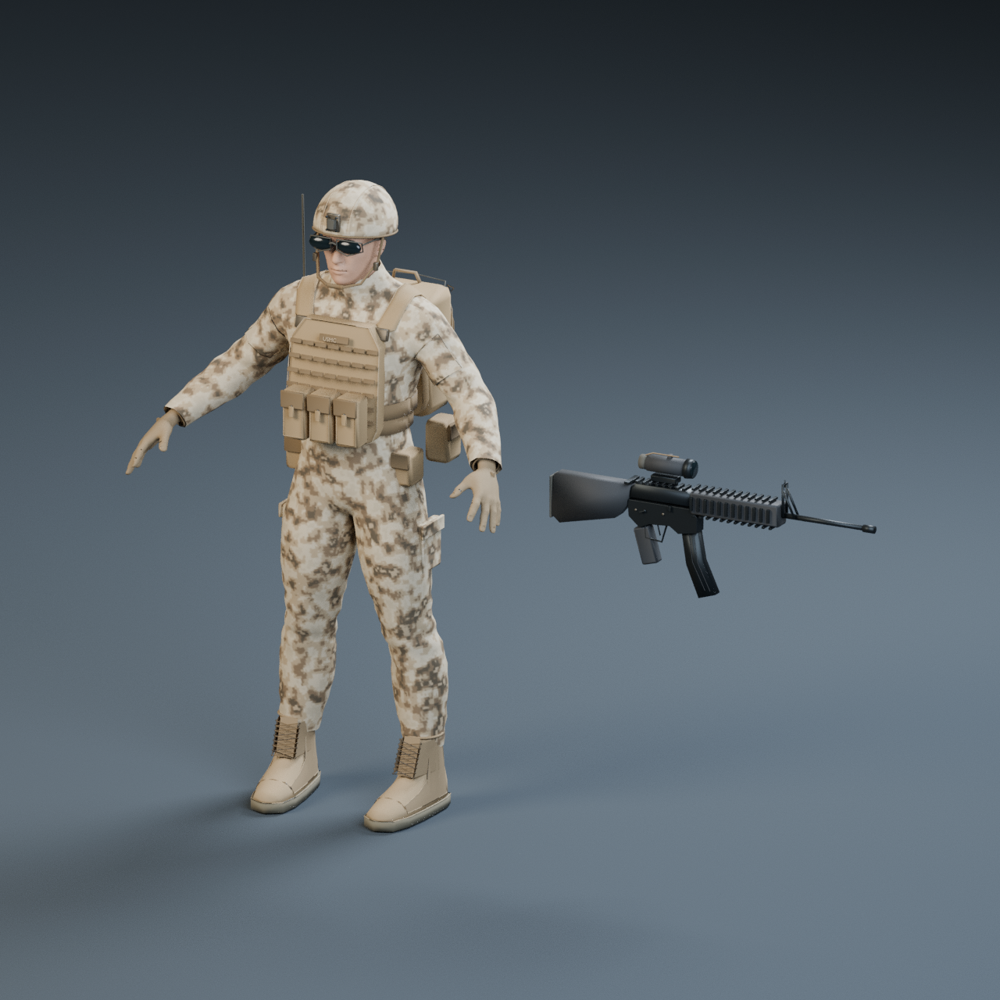

# USMC rifleman — real 3D A-pose asset

Start with [models/USMC_Rifleman_Kit.glb](models/USMC_Rifleman_Kit.glb). This is a textured, volumetric character plus a separately addressable M16A4 mesh. No sprite plane, reference-image billboard or game-code change is involved.

## Files

| File | Contents |
| --- | --- |
| [Kit GLB](models/USMC_Rifleman_Kit.glb) / [FBX](models/USMC_Rifleman_Kit.fbx) | Character, initial deformation skeleton and separate rifle parked beside the body |
| [Character GLB](models/USMC_Rifleman_Apose.glb) / [FBX](models/USMC_Rifleman_Apose.fbx) | Character and skeleton only |
| [M16A4 GLB](models/M16A4.glb) / [FBX](models/M16A4.fbx) | Independent rifle at its grip origin |
| `source/USMC_Rifleman.blend` | Editable, UV-mapped quad source with packed baked PBR images |
| `source/USMC_Rifleman_Geometry.blend` | Pre-bake mesh, procedural material source and initial weights |
| `source/USMC_Rifleman_Studio.blend` | Same asset with the actual preview camera, floor and lighting |
| `textures/` | Albedo, roughness, metallic and tangent-space normal PNGs; 2048² character, 1024² rifle |
| `previews/` | Actual Blender renders, including a fresh-import GLB render and mesh topology |
| `validation/` | Khronos results, isolated GLB/FBX import results and game-preservation checks |
| `tools/` | Reproducible modeling, baking, export, render and validation scripts |

GLBs embed all required PNGs. The roughness and metallic maps are packed by Blender into the standard glTF metallic/roughness texture on export. FBXs are binary 7.4 with embedded images; the separate texture maps are also supplied for engines whose FBX material importer needs manual PBR connections.

## Model and conventions

The approved corrected v0.3.3 soldier informed the desert clothing and equipment silhouette. This asset uses actual human anatomy, not the pixel sprite stretched into 3D. The underlying adult body is 1.78 m; the complete helmeted figure is approximately 1.823 m tall.

Modeled details include articulated five-finger gloves, shaped garment folds and sleeve/cargo pockets, desert digital camouflage, a thick helmet shell and bound rim, NVG bracket, chin straps, ballistic eyewear, curved carrier plates, MOLLE, magazine pouches, utility pouches, an asymmetric IFAK and radio, and an assault pack. The foot-shaped boots include separate quarters, tongues, crossed laces, eyelets, seams and tread. The rifle has a fixed stock, contoured receiver, controls, trigger guard, curved magazine, quad rail, sight tower, barrel and optic.

Blender uses metres, Z up, and character forward is −Y. GLB export converts to the standard Y-up convention. The body is in a neutral A-pose with matching rest bones and no animation clips. The kit rifle is deliberately detached and parked to the character's side; use the individual rifle export to attach it to a future hand/socket. Its local muzzle direction is −Y in Blender, and its origin is at the grip.

| Mesh | Editable vertices | Exported triangles | Baked materials |
| --- | ---: | ---: | ---: |
| Character | 32,166 | 58,986 | 1 |
| M16A4 | 4,610 | 8,712 | 1 |

UV and normal seams split some vertices in GLB: 47,499 character vertices and 8,232 rifle vertices. The editable source retains 28,392 character quads; export copies are triangulated and include explicit tangents. Every character vertex has at most four normalized bone influences. The initial CC0-derived skeleton has 163 bones, including face and fingers.

## Validation actually performed

Blender **4.3.2** built, baked and exported the asset. The official Khronos validator reports **0 errors and 0 warnings** on each of the three final GLBs. Additional checks cover complete GLB chunks, volumetric geometry, metre scale, indices, zero-area triangles, embedded PNGs, UVs, normals, tangents, normalized weights and the independent weapon node.

All six GLB/FBX files were copied into temporary folders and imported into fresh Blender scenes. Mesh counts, dimensions, skinning and embedded-image decoding passed without access to the source texture folder. `glb-roundtrip.png` renders the imported kit GLB itself. The small Icosphere created by Blender's glTF importer is a bone-display helper, not an exported asset mesh.

Visual review found and corrected a rearward helmet/eyewear fit, floating sleeve-pocket corners, underdeveloped boot details, collapsed bevel faces on thin equipment, and a boot upper/sole mismatch. The boot fix uses a flat D-shaped footbed, a matching sole outline, fitted quarter panels and connected eyelet stays. The small helmet pole rings are capped. Carrier offsets, curved upper panels, shoulder straps and cummerbund routing now follow ray measurements against the actual garment surface; pack mounting tabs bridge the rear-carrier attachment gap. Final renders show front, back, side, quarter, equipment closeups and source topology.

Existing game validation: **308 tests passed**, zero failures/skips, and the Vite production build passed. Existing tracked files outside `assets-3d/` remain identical to recovered commit `f80c0e510dcffe759f62a43d1bd3ddea510274db`. The model is kept outside the live game's asset pipeline.

## Actual renders

[Front](previews/front.png) · [Back](previews/back.png) · [Side](previews/side.png) · [Helmet/carrier](previews/head-and-carrier.png) · [Boots](previews/boots.png) · [Rifle](previews/weapon.png) · [Source topology](previews/topology.png) · [Imported GLB](previews/glb-roundtrip.png)



## Rebuild

Run from the repository root with Blender 4.3.2 or compatible:

```sh
blender --background --python-exit-code 1 --factory-startup -t 4 --python assets-3d/usmc-rifleman/tools/build_rifleman.py
npm install --prefix assets-3d/usmc-rifleman/tools --ignore-scripts
node assets-3d/usmc-rifleman/tools/validate-models.mjs
blender --background --python-exit-code 1 --factory-startup -t 4 --python assets-3d/usmc-rifleman/tools/validate_reimports.py
blender --background --python-exit-code 1 assets-3d/usmc-rifleman/source/USMC_Rifleman_Studio.blend -t 4 --python assets-3d/usmc-rifleman/tools/render_details.py
blender --background --python-exit-code 1 --factory-startup -t 4 --python assets-3d/usmc-rifleman/tools/render_export_preview.py
```

For separate checkpoints, set `AW_GEOMETRY_ONLY=1` for the builder, then load `USMC_Rifleman_Geometry.blend` with `tools/resume_finish.py`. `tools/reexport_glb.py` reloads a baked source for exporter-only changes. CPU Cycles is used; this installed Blender build has no optional denoiser or Draco library, so renders use path tracing and the GLBs are uncompressed.

## Production limits

The deliverable is an actual editable, textured 3D asset, not a finished animation package. The skin is an **initial reference skin**; it has not received a full extreme-pose deformation, retargeting or facial-rig acceptance pass. Animation clips, LODs and engine-specific import/polygon-budget approval remain work for the target production pipeline. The gloves/face and cloth wear are relatively simple, and some equipment retains a clean low-poly appearance. This is not a claim of commissioned scan/sculpt fidelity or exact photographic reproduction of the pixel reference.

No combat simulation, 2D animation, collision, AI or game integration was changed. No merge was performed.

## Provenance

The anatomy, morph targets and initial reference skeleton/weights are **CC0** MakeHuman asset data from commit `a8bc2d54ff0ac92e78ff71431b1023eda42bf482`. Exact original URLs, hashes and the asset license are in `source/third-party/provenance.json` and `LICENSE-MakeHuman-CC0.md`. Only licensed asset data was incorporated; no MakeHuman application code or proprietary reference-game assets were copied. Equipment geometry, material construction, UV bake/export pipeline and renders were authored for this repository.

Recovery note: `f80c0e5` was present locally at the start of this task, but no fetched remote branch contained it. This new asset branch preserves it in its ancestry, along with the existing game and animation work.
