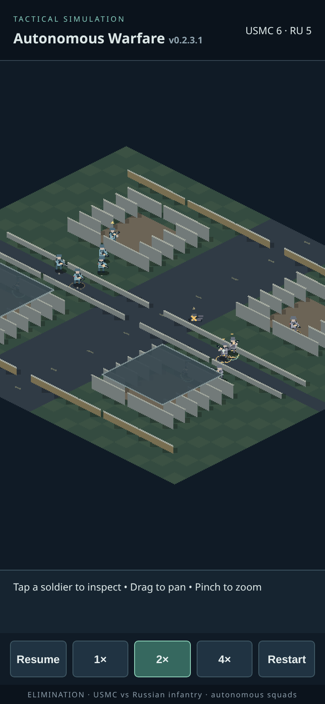

# v0.2.3.1 ordered stability audit

## Baseline and phase order

Confirmed prerequisite: latest fetched main `27166d9` merges v0.2.3 commit `c9bd0a7`.
Branch `fix/v0231-ai-stability-and-sprites` started from that merge. No AI or visual
source edits preceded the baseline. An immutable main archive was used for the baseline
and independent replays. The steps were: 200 baseline cases; ten worst-case replays;
focused AI fixes and four regression tests; the same 200 post-fix cases plus full
suite/build; then humanoid rendering; then a further 200 rendering-enabled cases,
full suite/build and mobile browser checks.

Exact inputs are in every `runs` row of [v0231-baseline.json](v0231-baseline.json):
LCG seeds **1–200**, constants 1664525/1013904223, unsigned 32-bit output divided by
2^32. Case `(seed-1)%4` selects standard, contactTTL=6 (default 8), half initial
reserve ammo, or initial left-leg health=65 for all soldiers. There are 50 cases of
each. These are existing constructor/health/ammo inputs, with no new map/scenario AI.
All remain 6v6. dt=0.1 simulation seconds, timeout 1,800 seconds. **All 200 baseline
and all 200 updated matches completed**; none timed out. This does not prove that all
possible seeds or ammunition stalemates finish.

Scripts are read-only observers using recorded events, known-contact snapshots,
activity counters and actual simulation state. They do not supply enemies to AI.
Per-step SHA256 digests include RNG state, time/result, positions, health, ammo,
reserves, AI action, facing, mounting data and assignment type. The ten longest
baseline cases were rerun separately; **all ten replay digests equal their baseline
records**. Replay snapshot health values are deep-copied (not retained mutable
references). The initial temporary traces were replaced by independently replayed
snapshots for diagnosis. No external reviewer/subagent was used.

## Paired results

Raw updated data: [v0231-post-ai.json](v0231-post-ai.json). Comparison including all
200 paired duration/casualty/passive deltas: [v0231-comparison.json](v0231-comparison.json).
Time values are seconds; contribution metrics are mean soldier-seconds per match.
Counts other than stalled are means per match. Quantiles use sorted index floor(N*p).

| Metric | Baseline | Updated |
|---|---:|---:|
| durationMedian | 68.500 | 66.700 |
| durationP90 | 105.800 | 105.600 |
| durationP95 | 125.400 | 123.400 |
| durationMax | 176.600 | 168.500 |
| duration | 74.516 | 72.940 |
| firing | 87.035 | 86.708 |
| passive | 132.865 | 129.861 |
| passivePercent | 26.215 | 26.002 |
| exposurePercent | 47.152 | 47.284 |
| usefulCover | 83.107 | 82.475 |
| relocations | 16.975 | 16.925 |
| abandoned | 17.145 | 17.105 |
| navigationFailures | 2.390 | 2.265 |
| reacquisitionMedian | 2.800 | 2.800 |
| reacquisitionP90 | 17.100 | 16.500 |
| deploys | 5.455 | 5.455 |
| unmounts | 5.120 | 5.110 |
| mountedShots | 34.295 | 34.290 |
| mountedTime | 9.513 | 9.519 |
| medicShots | 4.890 | 4.835 |
| treatments | 9.725 | 9.435 |
| medicTreatmentTime | 13.290 | 12.899 |
| casualties | 8.670 | 8.695 |
| dead | 4.230 | 4.250 |
| incapacitated | 4.440 | 4.445 |
| injured | 7.030 | 7.025 |
| stalled | 0.000 | 0.000 |
| loops | 1.655 | 1.670 |
| facingErrors | 22.975 | 0.000 |
| invalidShots | 0.000 | 0.000 |
| aimErrors | 0.000 | 0.000 |

22 durations improve, six worsen, 172 are unchanged. Improvements are modest:
median/P95/max duration, passive time, navigation failures and completed-sample
reacquisition p90 fall. Shot-facing errors fall from **4,595 to zero**. No blocked,
out-of-range or geometrically mis-aimed shots were measured in either version.
Do not read those checks as proof of every possible invalid-fire condition; existing
reload, death, mount and LOS regression tests provide additional coverage.

Regressions: engaging and protected-lane time fall slightly; exposure percentage
rises slightly; treatments fall from 9.725 to 9.435 ticks/match and treatment time
from 13.290 to 12.899 soldier-s; casualties/deaths rise slightly. Mounted contribution
is essentially unchanged. Potential cover-cycle flags rise from 1.655 to 1.670/match.
This release is not a claim of universally better tactics, safety or medical care.

Completed medic-response episodes: 664→652; median 8.4→7.9s and p90 48.3→46.2s.
Response starts at the first observed damage leaving any part below 65 and ends at
the next actual treatment tick. Untreated/dead episodes are censored, so this is not
a population-wide improvement claim. Initial leg-injury cases contribute to final
injury counts. End-of-match incapacitation is reported separately from death.

Reacquisition measures personal loss of all direct sightings for at least 0.5s until
that soldier sees an enemy again; unresolved episodes are excluded. Exposure uses
LOS to known, unexpired snapshots with protection below .28, rather than hidden live
positions. Useful cover is an in-range protected known lane. Those measures are not
complements under multiple threats. Successful cover journeys count once within
.25 tiles; abandoned journeys only while the soldier remains active. Loop flags
identify repeated cover destinations within ten seconds, not proven decision deadlocks.
Max-wait samples include valid reload/overwatch/injury restrictions and are not an
inactivity verdict by themselves. Winners, injury counts, casualty counts, responses,
reacquisition episodes and event counts are retained per case.

## Ten worst baseline cases and actual diagnoses

Selected by timeout first, then duration, then passive time. At 5s intervals, replay
snapshots record actual action, decision/rejection, position, health, ammo, progress,
movement blocker and mount state. Full snapshots are in `v0231-replays/baseline-SEED.json`;
compact selections and reason frequencies are in [v0231-worst.json](v0231-worst.json).
These are sampled traces, not an exhaustive frame-by-frame explanation.

| Seed / scenario | Duration | Diagnosis and disposition |
|---|---:|---|
|18 / short contact|176.6|Mobile survivors with torso 30–35 were repeatedly rejected for recon. Bounded survivor fallback addresses this gate.|
|130 / short contact|165.5|Includes severe leg damage (leg sum 56.4) and defensive waits. Severe mobility restriction remains legitimate; no forced crawl into exposure.|
|140 / leg injuries|156.1|Fit medic reserved while other armed roles remain; treatment/squad context constrains tasks. Fallback permits reassessment only after squad-wide inactivity and no fit fighter, with safe care still first.|
|114 / short contact|150.2|Multiple mobile survivors rejected at torso 23.7/31.5. Fallback allows the latter; near-incapacity torso below 25 remains excluded.|
|191 / reduced reserves|146.8|Two mobile fighters at torso about 28 remain defensive. Same bounded fallback; ammunition and survival checks preserved.|
|145 / standard|142.8|No sampled >15s lack-of-progress episode. Extended engagement/navigation (five failures) alone is not a confirmed passive-AI defect. Facing defect still applies.|
|104 / leg injuries|140.7|Medic reservation appears in prolonged waits. A reservation alone is not proof of safe treatment availability. Conditional role reassessment added; no treatment/LOS rule relaxed.|
|125 / standard|136.5|Injury exclusions, 18 navigation failures and casualty approaches. Remains a significant regression after correction; see below.|
|78 / short contact|131.4|Injury-restricted survivor plus frequent cover-goal changes. Detailed goal/bearing replay saved separately; churn is unresolved, not declared fixed.|
|73 / standard|125.4|Low torso and severe mobility damage constrain late search. Conservative restrictions remain; changes do not guarantee faster completion.|

[v0231-cover-replay-78.json](v0231-cover-replay-78.json) records 73 cover starts in
seed 78, including repeated nearby destinations with changed estimated threat
bearings and medic interruptions. Fifteen potential cycles were flagged. The evidence
does not justify eliminating those reactions or treatment priority; this remains a
specific diagnostic limitation, rather than a speculative cover-algorithm rewrite.
No permanent mounting deadlock or illegal geometric shot was confirmed in this set.

Significant regressions were inspected using baseline and updated replay snapshots:
seed **125: 136.5→168.5s, casualties 9→11, navigation failures 18→14**; seed
**155: 63.9→82.4s, casualties 9→7, treatment ticks 5→11**; seed
**186: 80.9→91.1s, casualties 9→10, failures 2→1**. Updated 125 snapshots show
injured LMG #4 following actual cautious sector-observation assignments at t=115,
135 and 150, then rifleman #3 at t=165. Seed 155 also records a cautious survivor
recon task; 186's divergence is not attributed to a cause absent from its sampled
trace. Neither navigation failures nor duration alone proves unsafe movement. Existing
safe observation routing, suppression and injury gates remain; no blanket urgency
or exposure relaxation was introduced. The small adverse casualty shift and seed-125
regression remain explicit review risks. Traces for all three before/after are committed.

## Confirmed corrections

1. **Movement overwrote firing/aiming facing.** Combat set facing and emitted a
   correctly aimed shot, then `move()` replaced it with travel direction. Preserve the
   current interval's shot direction; otherwise retain aim toward the selected enemy
   only while directly visible, active and in range. Use travel direction otherwise.
   Shot geometry, range, damage, cadence and RNG were not changed by this fix.
2. **All available investigators could be rejected by injury/reservation gates.**
   After *every living squad member* has lacked useful progress for >12s, if there
   is no fit non-medic investigator, permit existing safe observation planning for
   a mobile survivor with torso >=25 and suppression <.35. Leg sum >60, ammunition,
   reload/reaction checks and existing safe-route constraints still apply. Only one
   assignment is selected per coordinator pass; actual travel resets the stall gate.
   A fit medic can likewise be considered when armed teammates are unfit, but safe
   actionable care retains priority. Assignment reasons explicitly say cautious
   survivor reassessment. No health, treatment rate, death or injury threshold changed.

New regression tests verify actual assignment and movement, restrictions for recent
progress/severe mobility/suppression, medic release from an unreachable-patient
reservation, and combat-facing retention through movement. Existing behavior remains
covered by all previous tactical, navigation, suppression, medic and animation tests.

## Visual phase and parity

Original procedural humanoids replace the block torso silhouette: separate head/neck,
small helmet/brim, ten-pixel torso, vest/pocket, bent sleeved arms with hands on the
weapon axis, individual trouser legs and boots. USMC is muted blue-gray, Russian
infantry cool gray/lavender; role markers remain. Existing walking/running, aiming,
firing, reload, cover, suppression, injury, medical, mount/unmount, incapacity and
corpse poses are reused. No detailed faces, equipment customization, environmental
art, external imagery, lighting engine, sprite framework or collision changes.

A further **200 cases** exercise actual `CombatVisuals.update`, `drawUnit` and
`drawTraces` against a no-op graphics sink. Update runs each simulation interval and
shape drawing every tenth step; speed rotates among 1×/2×/4× by seed. Every per-step
simulation/RNG digest matches the post-AI baseline. Results are in
[v0231-post-visual.json](v0231-post-visual.json). Thus visual work preserves all 200
post-fix outcomes. Browser checks separately exercise real Phaser drawing. This
parity is against the AI-corrected version, not against original main.

## Tests, build, mobile and remaining verification

Both AI-only and final builds pass. Final `npm test`: **113 passing**, zero failures
(56 simulation +17 coordination +17 presentation +19 cover/mount +4 new stability).
`npm install` succeeds. Vite's pre-existing large Phaser chunk warning remains.
No new runtime dependency was added. Pages subpath/workflow and CSS layout are intact.

Mobile Chromium production checks: 390×844/844×390, touch LMG inspection, 144px
scrollable panel, no undefined/NaN text, pinch preserving selection, controls and
no horizontal overflow, pause/resume, restart 6v6, 1×/2×/4×. Ten-second 4× sample:
600 frames, median/P95 16.7ms, max 33.3ms on this host. Actual 2× portrait combat was
captured and visually reviewed. [v0231-browser.json](v0231-browser.json) stores results.
This is not physical Safari, thermal, battery or accessibility certification.

Physical iPhone Safari checklist:

- Verify the header is v0.2.3.1 after deployment. At 1×, inspect both faction silhouettes,
  hands/weapon direction and role markers at overview and pinch zoom.
- Follow a soldier firing while repositioning: gun aim should follow the selected
  visible target, rather than its travel direction. Observe blocked lanes too.
- Inspect a supported LMG: deploy, mounted recoil, reload and release must agree with
  actual state; no flashes during deployment, release, incapacity or death.
- Observe walking/limping, cover approach/hold, suppression, kneeling medical treatment
  and a treatment completion. Confirm medical timing and troop counts remain sensible.
- Run repeated late games, including injured survivors. Check cautious assignments and
  real progress; report seed/case when reproducible, diagnostic reason, device/iOS and
  speed for long waits or rapid cover changes. No claim that these are all eliminated.
- Test portrait/landscape, inspector scrolling, pan/pinch, pause/resume and restart at
  1×/2×/4×. Watch sustained frame rate and heat on the phone.

## Reproduction

```sh
npm install
npm test
npm run build
mkdir -p /tmp/aw-v0231-baseline
# Use a fresh archive directory.
git archive 27166d9 | tar -x -C /tmp/aw-v0231-baseline
node scripts/audit-stability.mjs /tmp/aw-v0231-baseline /tmp/before.json 200 trace
node scripts/audit-stability.mjs . /tmp/after.json 200 trace
node scripts/replay-audit.mjs /tmp/before.json /tmp/worst.json
# Optional seed filter is the sixth script argument (after trace):
node scripts/audit-stability.mjs /tmp/aw-v0231-baseline /tmp/replay.json 200 trace 18,130,140,114,191,145,104,125,78,73
node scripts/audit-stability.mjs . /tmp/visual.json 200 none '' render
node scripts/compare-stability.mjs /tmp/before.json /tmp/after.json /tmp/visual.json /tmp/comparison.json
```

The raw datasets and comparison are committed; 5s traces are retained for ten worst
baseline cases and three significant paired regressions. Temporary traces for the
other cases were omitted to avoid unnecessary repository bulk. Package version is
SemVer `0.2.3-1`; the displayed release name is v0.2.3.1.

Actual production capture (2×, paused, pinch-equivalent zoom):



Changed implementation files: `src/simulation.js` (aim retention),
`src/coordination.js` (bounded survivor/medic eligibility), `src/combat-visuals.js`
(procedural humanoid shapes), `test/stability.test.js` (four behavioral regressions),
three audit/comparison/replay scripts, release metadata, README and the evidence
files in `reports/v0231-*`. No map, CSS, navigation, suppression, injury/treatment
calculation or deployment-workflow file was changed.
