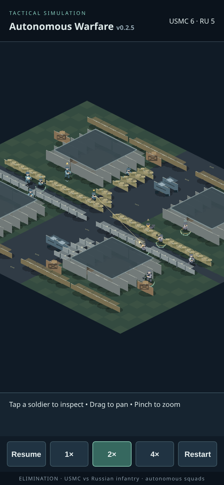

# v0.2.5 urban cover and fragmentation audit

Base: merged main `e6f28846c81b069d71adbdc20a5dbc113c8dda87` (v0.2.4 follow-up included).
Branch: `feat/v025-urban-cover-and-grenades`. No automatic merge or Pages deployment.

## Scope and audit order

Inspected world generation, directional cover probes, BFS navigation, symmetric DDA sight/bullet checks, suppression, mounting, squad assignments, medical safety checks and procedural presentation before implementation. Their shared obstacle map remains authoritative. Added the initial functional urban/grenade implementation, froze its sources, then ran **200 A + 200 B baseline simulations before targeted corrections**. Replayed the 15 longest cases with actual decisions. Applied focused corrections, then ran **the same 400 configurations after corrections**. The planned 800 runs are recorded: **399/400 baseline battles finished, one baseline timed out at the diagnostic 1800s cap; all 400 updated battles finished**. Thus 799 completed battles plus one recorded timeout, not 800 victories. The cap belongs to the audit only, never the game.

An extra 200 B replays added an independent grenade observer after a faulty diagnostic counter was discovered; all 200 per-step core hashes matched the immutable pre-correction dataset. Also replayed the 15 largest adverse paired changes before and after. Extra replays are not counted as new scenarios or substituted for the planned cohorts.

## Geometry and functional cover

`world.js` has one material catalog for movement, solid sight/bullet occlusion, directional hit protection, mounting eligibility and direct fragment attenuation. Long existing street-edge low-wall rows become sandbag and concrete lines, preserving their gaps. Added short vertical lines and a two-cell stepped diagonal, two paired-cell abandoned vehicles, and crate stacks. Streets, doors and flank gaps remain open. All **502 walkable cells are connected in each of three urban layouts**.

| Type | Bullet/sight geometry | Directional protection | Mount | Direct fragment transmission per crossed cell |
|---|---|---:|---|---:|
| Sandbag | Low; movement blocked, fire permitted over it | 0.62 | Yes, existing front/arc/LOS rules | 0.40 |
| Concrete | Low; movement blocked, fire permitted over it | 0.70 | Yes | 0.28 |
| Vehicle | Full height; movement/sight/bullets blocked | 0.76 | No | 0.12 |
| Crates | Full height; movement/sight/bullets blocked | 0.50 | No | 0.30 |

House walls still block sight/bullets and direct fragments completely. Fences retain existing behavior. Cover protection only applies when the obstacle lies toward the known threat; proximity alone gives no protection. Low cover reduces hit probability rather than stopping every shot. High obstacles require a firing position around their edge. No destruction or material penetration by bullets. Fragment attenuation multiplies once per crossed cell and uses the same corner-conservative DDA as sight. Multiple positions along a line use existing reservations, spaced movement and physical soldier collision; no shared singleton cover destination was added.

## Grenade mechanics and decisions

- Leader and three riflemen per squad get one frag each. LMGs and medics carry none. Constants in `FRAG`: 4.2–7 tile throwing distance, 0.7s preparation, 0.65s flight, 2.1s fuse from release, 3.5 tile blast radius, 8s squad cooldown. No RNG draws are added by grenades.
- Only enemies in the thrower's **own current confirmed sight** can authorize a throw. Need a cluster of at least two within 1.8 tiles, or a covered confirmed position with at least three seconds since squad damage progress. Moving, recon-assigned, cover-moving, reloading, heavily suppressed or badly arm-injured soldiers do not start a throw. They never chase an opportunity or replace the leader's assignment.
- Friendly safety includes all living allies, incapacitated casualties and the thrower, plus a conservative swept route prediction over the fuse with a 0.6-tile margin. Rechecked before release. One preparing soldier reserves the squad opportunity; no simultaneous preparation bypass. Preparation may cancel without consuming inventory. The target is a frozen observed snapshot; during the brief preparation it never follows an unseen enemy.
- Straight clear sight to the snapshot is required; low barriers may be thrown over. The rendered parabola is cosmetic. No bouncing, full-height wall lobs or indirect unseen targeting.
- Blast pressure is `(1-distance/radius)^2 × obstruction transmission`. It causes suppression and deterministic damage through existing `Battle.injury` to head, torso, left leg and right arm, with fixed scales 0.35/0.65/0.8/0.5 and base 120. Both teams take identical damage. This coarse radial fragment envelope is not physical shrapnel and does not guarantee a kill on a fresh healthy soldier at its center.
- A grounded grenade must be seen within six tiles. Detection gives only its seen position, not an attacker identity or an omniscient mid-flight landing point. Reaction delay is 0.25–0.39s plus suppression. Each grenade memory retains its deadline. Delayed emergency evasion considers reachable lower-risk destinations and normal collision/unmounting; it can fail or be too late. The squad assignment remains intact and normal decisions resume after the danger. Nonessential treatment/reload can be interrupted; no healing speed or immunity changes.
- Throw preparation, release, arc, fuse marker and restrained pixel blast consume authoritative states/time. Rendering does not draw RNG or apply damage. Existing humanoids, mounting, health, medic animation and seven exclusive activity categories remain; preparation counts as preparation, a real release as engaging. Inspector adds actual frag inventory/action and correctly disallows fire during preparing/throwing/evasion.

## Confirmed defects corrected after the baseline

1. **Preparation race:** cooldown began only at release, allowing four eligible squad members to prepare together. Reserve the squad slot at preparation, release on cancellation/death, retain cooldown/live-ordnance gate. Initial opportunity cases drop from four/five simultaneous throws to sequential, limited use.
2. **Reaction deadline reset and alert counting:** a single overwritten threat record reset readiness when multiple grounded grenades were processed; repeated detections inflated statistics. Per-grenade memories retain observation/reaction deadlines; selection uses perceived danger. Count real reaction attempts and actual reacted survivors separately.
3. **Insufficient friendly prediction:** checking only the first waypoint missed allies entering the blast area later within the fuse. Sweep consecutive route segments using a conservative walking budget. Friendly fire remains possible after unpredicted route changes and is never disabled by team.
4. **Unresolved ordnance at victory:** elimination could freeze a still-live grenade. Resolve pending ordnance before finalizing elimination; a killed thrower's live grenade still detonates.
5. **Blast/sight geometry divergence:** sampled fragment rays could disagree with exact bullet corner geometry. Reuse the symmetric DDA and attenuate each material cell once.
6. **Urban care deadlock (1155):** a short, quiet approach just above the old risk cutoff was rejected while care reservation stopped useful recon. In urban mode only, allow risk average up to 0.70 for a route ≤3 cells, ≤1 exposed cell, protected patient endpoint, low suppression, no nearby recent incoming report and no recent known firing. Ordinary 0.60 rule remains for other routes, especially active fire. This does not infer ammunition or unseen positions and does not change legacy decisions.
7. **Quiet-permission cache transition:** a final test without manually clearing the cache reproduced acceptance of the quiet approach after firing resumed. Urban cache keys now include recent-fire/suppression danger so the extra permission is invalidated immediately. All 400 final configurations were rerun after this correction; 200 legacy hashes still match. Eight urban cases change relative to the preceding corrected trial, including worse durations in 1103 and 1121. The intermediate/final summaries and changed seeds are preserved in `v025-revision-metrics.json`. This additional 400-run verification is separate from the original 800-run plan.
8. Cancel preparation after combat incapacity/major arm damage. New inspector reasons come directly from actual grenade actions; no manufactured tactical explanations.

## Paired measurements

A: legacy map, grenades off. B: urban map, grenades on. These are **within-cohort before/after comparisons**, not a claim that new art or grenades alone improve every statistic. Durations are simulated seconds. All other time values are summed active soldier-seconds unless labeled. Percentiles use sorted `floor(N*p)`; incapacitation is final living inactive status, not historical transitions.

| Metric | A before | A after | B before | B after |
|---|---:|---:|---:|---:|
| Duration median, s | 64.60 | 64.60 | 55.00 | 59.70 |
| Duration P90, s | 98.90 | 98.90 | 91.20 | 91.40 |
| Duration P95, s | 113.60 | 113.60 | 102.00 | 103.10 |
| Maximum including timeout cap, s | 170.40 | 170.40 | 1800.00 | 206.20 |
| Timeouts / 200 | 0 | 0 | 1 | 0 |
| Engaging, soldier-s / match | 85.38 | 85.38 | 123.34 | 131.91 |
| Passive waiting, % active time | 25.59 | 25.59 | 21.06 | 20.78 |
| Exposure, % known-threat time | 48.56 | 48.56 | 40.05 | 45.04 |
| Useful cover, soldier-s / match | 81.27 | 81.27 | 140.53 | 136.33 |
| Cover arrivals / match | 15.98 | 15.98 | 12.39 | 13.12 |
| Abandoned cover goals / match | 16.97 | 16.97 | 11.05 | 13.12 |
| Cover cycle flags / match | 1.23 | 1.23 | 0.69 | 0.79 |
| Navigation failure increments / match | 2.21 | 2.21 | 1.28 | 1.69 |
| Mounted LMG shots / match | 32.65 | 32.65 | 36.80 | 46.70 |
| Mount deployments / match | 4.76 | 4.76 | 3.78 | 4.29 |
| Unmounts / match | 4.46 | 4.46 | 3.29 | 3.94 |
| Medic treatment, soldier-s / match | 13.41 | 13.41 | 5.69 | 7.92 |
| Personal reacquisition median, s | 2.80 | 2.80 | 2.90 | 3.10 |
| Personal reacquisition P90, s | 15.80 | 15.80 | 13.90 | 14.50 |
| Combat-ineffective soldiers / match | 8.60 | 8.60 | 8.43 | 8.72 |
| Deaths / match | 4.25 | 4.25 | 4.32 | 4.16 |
| Living incapacitated / match | 4.35 | 4.35 | 4.11 | 4.56 |

| Metric per medic-match | A before/after | B before | B after |
|---|---:|---:|---:|
| Treatments completed | 0.74 | 0.34 | 0.46 |
| Treatments interrupted | 2.27 | 0.88 | 1.14 |
| Casualty rate, % | 56.25 | 57.25 | 58 |
| Rifle shots | 2.60 | 3.21 | 5.00 |
| Navigation failures | 0.80 | 0.46 | 0.53 |

Legacy A matches **all 200 per-step core hashes**, including RNG state, position, injuries, ammunition, AI state, facing, mounting and assignment type. Physical results/per-soldier data also match the first 200 original v0.2.4 follow-up C cases. Hashes against the historical report differ only because mounting reason wording was generalized for new low barricades before this audit; A before vs A after matches exactly. Legacy compatibility is explicit `Battle(...,{map:"legacy",grenades:false})`; defaults preserve old headless callers. The browser opts into urban/grenades. There is still one shared active geometry map, reactivated at construction/step; helpers used outside a step must activate the corresponding world. This supports deterministic sequential cohorts, not simultaneous independent live scenes.

B throws/detonations: **227/220 → 120/120**. Effective uses (at least one enemy receives >10 base scaled damage): **218 → 118**; not a kill count. Friendly-fire victims: **0 → 0** in these cases; dedicated tests prove friendly damage exists. Independent observer unique *selected* alerts **367 → 348**, reaction attempts **72 → 220**, successful reactions **64 → 90**. Success requires an active survivor with >50% reduction of distance-only risk relative to first alert, checked at detonation; it deliberately excludes shelter attenuation and can differ from internal protection-aware counters. Attempt success share falls **88.9% → 40.9%** because many more threatened soldiers now attempt reactions; evasion is not guaranteed. The old raw `grenades.detections` and `safeReactions` were defective and must not be interpreted as comparable successes.

**Negative results and sensitivity:** median B duration rises 55.0→59.7s; P95 worsens 102.0→103.1s. Completed-match maximum rises **140.3→206.2s**, despite eliminating the 1800s timeout. Cover abandonment, cycle flags, navigation failures, casualties, medic interruptions and reacquisition delays worsen. Absolute medic treatment and LMG contribution increase, but medic casualty rate worsens 57.25→58.00%. Do not describe this as uniformly better medical safety or cover discipline.

The removed timeout distorts pooled ratios: excluding seed 1155 from BOTH versions, passive waiting rises approximately **19.40%→20.73%**, exposure **44.30%→45.12%**, useful cover **123.04→135.90 soldier-s/match**, engaging **123.16→131.62**, and mean duration **53.24→61.08s**. Thus the all-run passive percentage improvement is not evidence of broadly more active AI. Role data and all paired adverse deltas remain in comparison JSON files.

Navigation increases mainly in medics (0.46→0.530 failures/medic-match) and riflemen (0.014→0.048), with actual transient soldier congestion in adverse cases 1104/1052/1072. No disconnected terrain was found. We retained existing route recovery rather than adding speculative movement/aggression rules. No invalid shot, aiming-angle or firing-facing discrepancy was observed in either cohort; this does not guarantee their absence outside these seeds.

## Fifteen longest baseline cases

Selection: descending duration across both initial cohorts, including the timeout. Every trace was replayed and core hash checked against its raw case. Observations below are supported by actual sampled decisions, not a claim that every long fight is defective. The traces sample every ten seconds and preserve grenade events; they are not exhaustive frame-by-frame tactical proofs. The final 15 adverse paired cases are reselected after the cache correction, and both versions replayed again.

| Seed/cohort | Before → after, s | Trace-supported diagnosis |
|---|---:|---|
| 1155 / urban | 1800.0 → 88.9 | Confirmed medical/coordination deadlock. At 1780/1790s both LMGs have 0 ammo and reserve. Medics retain care duties; medic #11 alternates short recon/care beside patient #10. Its two-cell approach has risk average ≈0.65, one exposed cell, protected endpoint and no recent fire; old 0.60 cutoff rejects it. Narrow quiet-approach exception resolves this case. No enemy ammunition is consulted by the fix. |
| 92 / legacy | 170.4 → 170.4 | Late injuries restrict recon: #1/#7 defensive, while #5 fires then treats #2 and #11 travels to a casualty. Finishes without a new-feature defect; retained. |
| 46 / legacy | 155.8 → 155.8 | Injured rifleman #3 patrols then becomes pinned; LMG #10 searches, then takes a bounded retry cooldown. Search/fire continues; no permanent hold demonstrated. |
| 97 / legacy | 142.0 → 142.0 | Late recon by #2/#4, overwatch by #1, care approach by #5; #9 alternates injury/suppression restrictions. Slow search, not an immobile squad-wide deadlock. |
| 1097 / urban | 140.3 → 58.2 | At 130s medic #5 pinned and LMG #10 injury-limited; at 140s both engage. Sparse survivor fight. No mounting deadlock or invalid shot observed. |
| 146 / legacy | 128.8 → 128.8 | Injury-limited defensive survivors; #10 still changes position between 110s and 120s. Slow bounded endgame retained, not diagnosed as a cover lock. |
| 120 / legacy | 124.7 → 124.7 | Last LMG reloads, leader #6 seeks cover under suppression, then both engage. Valid combat/reload/cover sequence. |
| 1179 / urban | 123.0 → 125.1 | Low-ammunition LMG, medics reserved for care, rifleman #3 changes cover then fires; at 120s enemy medic fires. Medical reservation/search remains a limitation, not safely fixed globally. |
| 1031 / urban | 122.6 → 93.3 | Two surviving LMGs patrol/search with cooldowns; both have firing opportunities by 120s. No permanent support-state lock. |
| 1151 / urban | 119.1 → 149.7 | Medical approaches/treatment and depleted enemy LMG; medic #11 remains care-reserved at a distant location. Existing medical reservation can prolong search. Updated duration worsens; documented. |
| 20 / legacy | 118.9 → 118.9 | Recon and active treatment: #2 pauses for medic #5 while LMG #4 provides search overwatch; injured enemy medic holds. Treatment hold has an actual contributor. |
| 9 / legacy | 118.0 → 118.0 | #2/#4 search different sectors with overwatch; injury-limited #8 later seeks cover. Bounded search, no unreachable region. |
| 1194 / urban | 117.0 → 134.2 | Protected firefight with a real medic reload then engagement; direct fire remains active. Updated fight lasts longer; no invalid LOS shot observed. |
| 56 / legacy | 115.4 → 115.4 | Medics travel/treat; patient #9 receives actual treatment; LMG #10 reacquires. Late medical/combat cycle, not pure waiting. |
| 36 / legacy | 114.8 → 114.8 | #3 searches then patrols while #10 reacquires and briefly cools down; #9 is injury-limited. No indefinite navigation objective in sampled trace. |

## Adverse paired cases investigated

All following cases were replayed in both versions, with source snapshots and hash verification. Most large deltas are the deliberately clustered leg-injury scenario: preventing simultaneous grenade spam preserves enemy survivors and produces a longer real fight. This is not justification to hide the worse duration or navigation figures.

| Seed | Before → after, s | Throws before → after | Navigation before → after |
|---|---:|---:|---:|
| 1050 | 70.6 → 206.2 | 0 → 1 | 3 → 4 |
| 1072 | 19.1 → 120.4 | 4 → 2 | 0 → 1 |
| 1064 | 11.2 → 85.0 | 4 → 2 | 0 → 3 |
| 1136 | 16.5 → 87.8 | 4 → 2 | 0 → 2 |
| 1172 | 12.6 → 83.7 | 4 → 2 | 0 → 4 |
| 1103 | 64.5 → 133.4 | 0 → 0 | 0 → 0 |
| 1104 | 24.0 → 92.6 | 4 → 3 | 0 → 7 |
| 1168 | 8.9 → 76.4 | 4 → 2 | 0 → 1 |
| 1176 | 13.6 → 76.8 | 5 → 2 | 1 → 2 |
| 1068 | 18.9 → 78.6 | 4 → 2 | 0 → 1 |
| 1152 | 16.0 → 72.2 | 4 → 2 | 0 → 1 |
| 1156 | 9.8 → 64.6 | 4 → 3 | 1 → 5 |
| 1036 | 11.0 → 62.0 | 4 → 2 | 0 → 1 |
| 1052 | 19.1 → 65.7 | 4 → 3 | 0 → 5 |
| 1012 | 13.9 → 60.4 | 4 → 2 | 0 → 0 |

Seed 1050 has one updated throw versus none before. At 80–130s soldiers #0/#3/#6 repeatedly fire while #5 treats #4 and #11 repeatedly treats #6. At 140–200s #4 deploys/fires/reloads, #6 fights/reloads and #11 continues real treatment. Updated medics complete 6 and 13 treatments, with 105.3 combined treatment seconds. Existing unlimited protected treatment prolongs the firefight; it is not an unmount deadlock. We did not alter healing/balance or force a charge to make this case shorter. Seed 1104's sampled blockers are actual soldier congestion during medic patrol/care, not an inaccessible map cell. In the newly adverse seed 1103 (no grenades), #5 genuinely restores #4 to activity around 80s; #4/#11 fire/reload around 90–100s, #8 reconnoiters at 110s and engages at 120–130s. It finishes at 133.4s, 32.8s slower than the previous corrected trial. This is retained as a negative medical-transition outcome, not hidden as a grenade effect. Medical task reservation still produces long holds for some injured survivors and remains a known limitation.

## Exact reproduction and artifacts

- A seeds **1–200**, B seeds **1001–1200**. Modulo-four scenarios in each: standard, six-second contact TTL, half reserves, left-leg health 65. All others use eight-second TTL. B layout variant = seed % 3. Each JSON run records the complete map/grenade options and all 12 initial positions.
- Fifty B cases (seed divisible by four) use the recorded clustered contact setup, also the leg-injury scenario. This deliberate stress cohort is biased toward grenade opportunities and is not an unbiased balance sample. Ordinary spawns remain unchanged in the shipped browser.
- RNG: 32-bit LCG `r=(r*1664525+1013904223)>>>0`, output `r/4294967296`. dt=0.1s; no outcomes altered by sampling. Browser uses existing 0.05s step; separate tests group presentation at 1×/2×/4× with identical steps.
- Raw: `v025-before-A/B.json`, `v025-after-A/B.json`; summaries/roles/paired deltas: `v025-comparison-A/B.json`; initial worst cases/replays: `v025-worst*.json`; adverse paired cases/replays: `v025-adverse*.json`.
- `v025-pre-correction.patch` reconstructs the frozen initial feature source against base e6f2884; it was applied to a fresh archive and every source file compared to the archived baseline. Keep that baseline separate from the final checkout.

```sh
# Current code, exact cohorts
node scripts/audit-v025.mjs . /tmp/A.json 200 trace '' legacy
node scripts/audit-v025.mjs . /tmp/B.json 200 trace '' urban
# Optional: a recorded subset, without changing seed index/layout rules
node scripts/audit-v025.mjs . /tmp/B-1155.json 200 trace 1155 urban
node scripts/compare-v025.mjs reports/v025-before-B.json /tmp/B.json /tmp/paired.json
node scripts/replay-v025.mjs . reports/v025-worst.json /tmp/worst.json

# Reconstruct the initial feature baseline (not production code)
mkdir -p /tmp/aw-v025-initial
 git archive e6f28846c81b069d71adbdc20a5dbc113c8dda87 | tar -x -C /tmp/aw-v025-initial
 git -C /tmp/aw-v025-initial apply "$PWD/reports/v025-pre-correction.patch"
node scripts/audit-v025.mjs /tmp/aw-v025-initial /tmp/initial-B.json 200 trace '' urban
```

## Tests, build and browser verification

`npm install`, `npm test`: **149 passing (130 inherited + 19 new)**. New deterministic regressions cover all three layouts' connectivity, horizontal/vertical directionality, low firing lanes, full-height occlusion, detours/shared line spacing, LMG eligibility, fuse/obstruction/friendly injury, swept-route friendly rejection, own-sight opportunities, reservation, real release/inventory, retained assignment after delayed evasion, multiple-threat deadline stability, hidden grenade occlusion, pending ordnance after death, quiet medical approach vs recent fire, actual animation/inspector states, and render grouping determinism. No healing, rifle/LMG damage, accuracy or fire-rate values changed.

`npm run build` succeeds at the existing `/annous-warfare/` base; Pages workflow unchanged. Existing Phaser bundle still produces Vite's >500kB chunk advisory. No new runtime dependency or external asset.

Mobile Chromium evidence is in `v025-mobile.json`. The checked script is `scripts/mobile-v025.mjs` (requires an externally installed Playwright and Chromium; optional `AW_PLAYWRIGHT_MODULE`, `AW_BROWSER_URL`). It exercises tap/scroll inspection, actual image changes from touch pan/pinch, preserved selection, portrait/landscape, pause/resume/restart, all speeds and ten seconds of centered 4× playback. Desktop headless timings are not physical iPhone performance. Fresh centered screenshots were visually reviewed for horizontal cover readability and retained humanoids. The existing unbounded camera can pan away from the map; reload recenters it. Restart preserves the camera.

Physical iPhone Safari checklist after review/merge and successful Pages Actions deployment:

1. Open https://dydtjs345-ux.github.io/annous-warfare/ in a fresh/private tab; verify v0.2.5 and complete asset loading.
2. Check both orientations, scroll the compact inspector, pan/pinch to the long tan sandbag and grey concrete lines; multiple soldiers should occupy separate places. Pan back if outside the map.
3. Watch soldiers shoot over low cover and move around vehicles/crates; verify LMG deployment/arc/unmounting and no apparent through-wall fire.
4. Watch real grenade preparation, visible flight, fuse and delayed blast; inspect inventory depletion. Grenades are conditional and some matches have none. Confirm reactions can fail and survivors resume squad tasks.
5. Observe a casualty approach/treatment and return to combat; inspect actual injuries and exclusive activity time. Do not treat a defensive hold as automatically stuck.
6. Exercise 1×/2×/4×, pause during a flying grenade/fuse, resume, restart, and a full late-game outcome. Check touch latency, frame drops, heat/battery and any long survivor medical/search cycles on the actual device.

Remaining limits: coarse blast/shrapnel and low-height model, no destruction/penetration/lob ballistics, conservative friendly prediction can reject useful throws or miss future route changes, bounded evasion may choose a poor route or arrive too late, casualty congestion and care reservation still cause delays, unlimited existing medicine can extend fights, no guarantee against ammo-exhaustion stalemates outside the sample, singleton map context, no physical Safari measurement. No unrelated architecture, campaign, weapons, graphics overhaul or player orders were added.


## Changed files

- Model/geometry: `src/world.js`, `src/grenades.js`, `src/simulation.js`, `src/tactics.js`, `src/mounting.js`.
- Presentation/inspection: `src/urban-visuals.js`, `src/combat-visuals.js`, `src/presentation-state.js`, `src/diagnostics.js`, `src/inspection.js`, `src/main.js`.
- Tests/tools: `test/urban-grenades.test.js`, `scripts/audit-v025.mjs`, `scripts/compare-v025.mjs`, `scripts/replay-v025.mjs`, `scripts/mobile-v025.mjs`.
- Version/docs: `index.html`, `package.json`, `package-lock.json`, `README.md`.
- Audit artifacts: `reports/v025-before-A.json`, `reports/v025-before-B.json`, `reports/v025-after-A.json`, `reports/v025-after-B.json`, `reports/v025-comparison-A.json`, `reports/v025-comparison-B.json`, `reports/v025-worst.json`, `reports/v025-worst-before-traces.json`, `reports/v025-worst-after-traces.json`, `reports/v025-adverse-cases.json`, `reports/v025-adverse-before-traces.json`, `reports/v025-adverse-after-traces.json`, `reports/v025-pre-correction.patch`, `reports/v025-revision-metrics.json`, `reports/v025-mobile.json`, `reports/v025-validation.json`, `reports/v025-mobile-cover.png`, and this report.


