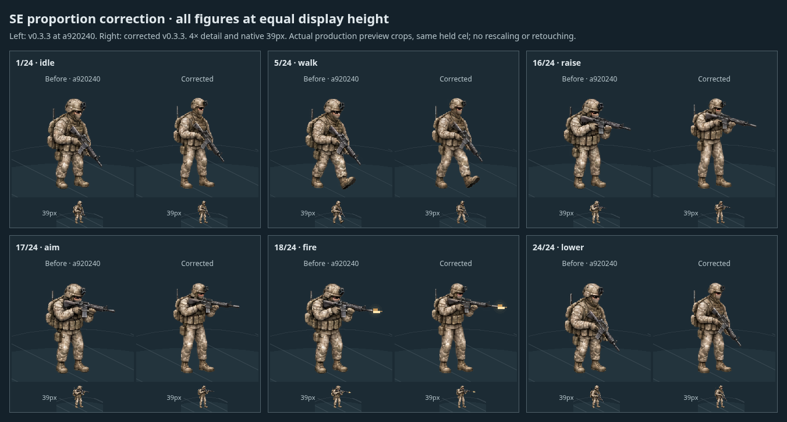

# v0.3.3 resumed SE proportion correction

Continues `feat/v033-usmc-proportions` from the confirmed remote head `a920240`.
The workspace was empty; the existing branch was cloned without a reset, rebase,
or force push. The first-pass reports and v0.3.2 assets are preserved.

The second atlas edit reduces the head and helmet together, narrows the equipped
torso/shoulders, and raises the waist for longer apparent thighs and shins in all
24 SE cels: idle, eight walk phases, raising, aiming, recoil/recovery and lowering.
Camouflage, carrier, pouches, backpack, boots and the connected hands/rifle remain.
This is a raster art correction; every runtime source module, including the
animation clock and preview renderer, is byte-identical to `a920240`.

## Before/after screenshots



- [All 24 cels, paired before/after at 39px and 4×](all-24-frames.png)
- [Mobile production preview, 390×844](v033-mobile-preview.png)
- [Production idle](production-frame-1.png) · [walk](production-frame-5.png) ·
  [raised rifle](production-frame-16.png) · [aim](production-frame-17.png) ·
  [fire](production-frame-18.png) · [final low-ready](production-frame-24.png)
- [Full production sequence, MP4](sequence.mp4), 980×950, 12.84 seconds.

The paired sheets compare the **previous v0.3.3 at a920240** with the corrected
v0.3.3. Each is an unretouched browser screenshot crop, with the same held pose,
39px nominal display height and 4× detail. The production preview/mobile/video
retain the existing **v0.3.2 versus current v0.3.3** comparison. Both formats use
the production build; the before/after harness routes only the baseline PNG and
metadata from `git show a920240`, without modifying the checkout or runtime.

The edited PNG is stored unchanged from the image editor. Its measured upright
envelope is 201px, with one registered root `(132,247)` across all cels; both banks
are uniformly normalized to 39px. Bounds and muzzle tips were remeasured from
alpha >=128. All 24 decoded silhouettes remain inside their cells; no visible
cell-edge content or detached muzzle marker was found. Region fingerprints
confirm changes in head/helmet, upper-body and lower-body areas of every cel;
these checks establish coverage, not anatomical quality.

I reviewed the complete paired sheet, the individual production poses and the
mobile capture. The reduced upper-body bulk and higher waist make the legs read
longer at equal height, including aimed and bent-knee poses. No clipping or
detached hands/rifle was visible in those captures. The original approximate
10–15% apparent-leg, ~5% helmet and 5–8% torso guides are not claimed as exact
per-frame anatomical measurements. Generated cloth/kit variation, jog-like bent
knees and four-key-pose raise/lower transitions remain limitations. Physical
iPhone Safari remains unverified.

## Validation

- **258 tests passed, 0 failed**, plus separate focused reruns of the 3 proportion
  tests and 8 SE animation tests. [Full log](tests.txt).
- [Production build passed](build.txt); the existing Vite large-chunk advisory remains.
- Every `src/` file and every earlier art asset matches `a920240` byte-for-byte,
  including the original v0.3.2 source. No simulation, AI, gameplay, clock,
  preview renderer, dependencies or other directions changed.
- **40 matched configurations / 80 complete battle executions**, using the
  existing `384e6e9` main baseline and seeds 2001–2020 on legacy/expanded maps.
  All outcome, duration and replay digests match the inherited archive.
  [Replay results](v033-parity.json).
- All 24 held frames render at equal nominal height, without anisotropic scaling,
  rotated weapon objects, clipping, page errors or failed requests.
  Browser-decoded alpha bounds match metadata, with visible muzzle-tip pixels.
- Full playback at **1×, 2×, 4×** reaches all nine stages and two shot cues per
  sequence. The 1× recording covers all 24 cels; pause freezes the full pose.
- Mobile Chromium passes touch scrolling, orientation changes, frame stepping,
  three close/reopen cycles, running/paused battle restoration and large-zoom
  stacking. **16 layout changes, 0 clipped cases**. The five-second mobile sample
  had P50 16.7ms and P95 33.3ms while other validation was active; this is not
  a performance improvement claim or a physical-device benchmark.

[Validation summary and hashes](validation.json) · [held-frame records](frames.json) ·
[mobile checks](v033-mobile-preview.json) · [layout checks](v033-layout-check.json) ·
[playback samples](v033-animation.json).

## Reproduce

```sh
npm ci
npm test > reports/v033-correction/tests.txt 2>&1
npm run build > reports/v033-correction/build.txt 2>&1
npm run preview -- --port 4233
# In another terminal, with Chromium and Playwright available:
node scripts/capture-v033-correction.mjs
AW_REPORT_DIR=reports/v033-correction node scripts/mobile-v033-preview.mjs
AW_REPORT_DIR=reports/v033-correction node scripts/check-v033-layout.mjs
AW_REPORT_DIR=reports/v033-correction node scripts/record-v033.mjs
ffmpeg -hide_banner -loglevel error -f concat -safe 0 \
  -i /tmp/aw-v033-video/concat.txt -vsync vfr -c:v libx264 -crf 22 \
  -pix_fmt yuv420p -y reports/v033-correction/sequence.mp4
ffprobe -v quiet -show_entries format=duration:stream=codec_name,width,height \
  -of json reports/v033-correction/sequence.mp4 > reports/v033-correction/video-info.json
mkdir -p /tmp/aw-v033-base
git archive 384e6e9 src package.json public/assets/usmc-se-v032 | tar -x -C /tmp/aw-v033-base
AW_REPORT_DIR=reports/v033-correction node scripts/check-v033-parity.mjs /tmp/aw-v033-base
node scripts/verify-v033.mjs
```

`AW_PLAYWRIGHT_MODULE` can point to an externally installed Playwright module.
Playwright was installed locally for evidence capture without changing either
package manifest or lockfile. The verifier reads the new correction evidence;
the first-pass evidence is retained under its original names.

The change is confined to the requested feature branch. Nothing is merged into
`main`, and feature-branch pushes do not deploy production Pages.
