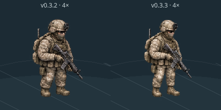

# v0.3.3 — USMC SE proportion refinement

> Historical first-pass report through `a920240`. Its screenshots, measurements,
> videos and validation files are preserved. The resumed head/helmet/torso/lower-body
> correction and current evidence are in [v033-correction/README.md](v033-correction/README.md).

Branch: **feat/v033-usmc-proportions**. Started from latest main **384e6e9**, the merged v0.3.2 release (PR #19). The v0.3.2 atlas is retained byte-for-byte. **Only SE** is refined; no gameplay systems or other directions change.

## What changed visually

A new transparent, complete-body PNG redraw refines all **24 SE cels**: idle/low-ready, eight walk poses, rifle raising, aiming, firing/recovery and lowering. Visible pelvis/waist placement is higher, thigh/shin shapes are longer, the equipped torso is slimmer, and the helmet silhouette is smaller. Shoulders/elbows and the rifle-holding pose are redrawn with the torso. Boots, gloves, camouflage, carrier, pouches, backpack and M16A4-style detail remain present.

The requested **10–15% apparent leg increase / ~5% helmet reduction / ~5–8% torso narrowing** were the art brief's starting guides. They are **not claimed as certified measurements of every cel**. The candidate was judged visually at equal character height rather than by forcing three rigid scale factors. It is still an artist-review candidate, not a claim of anatomically perfect production art.

This is **not a whole-sprite vertical stretch**. Anatomy/equipment placement is in a new raster redraw. Runtime applies only uniform display-size normalization and the existing whole-body cel playback. Both hands, arms, shoulders and rifle remain in a single image; there is no independently rotated rifle or per-limb stretching.

| Asset/registration | v0.3.2 | v0.3.3 |
|---|---:|---:|
| Atlas / logical cell | 1024×1536 / 256×256 | Same |
| Complete body cels | 24 | 24 |
| Native upright design envelope | ~200px | ~205px |
| Registered root/ground origin | (132,241) | (132,246) |
| Default game-scale height | 39px | 39px |
| Default magnified height | 156px | 156px |

The native envelope and root account for the edited image's pixels. They do not enlarge the character in the comparison: each atlas is uniformly normalized to the same 39px display height. The original boots' grounded reference and the new boots' grounded reference land at the same screen origin. Roots stay fixed across each bank's cels; no per-frame bounding-box auto-centering is used.

`public/assets/usmc-se-v033/source-atlas.png` is an original image-editing redraw of the project's original v0.3.2 art, not a crop from concept illustrations or the supplied phone screenshot. The PNG is committed unchanged from the editing tool. Metadata records cell IDs, solid-alpha bounds, registered roots and new drawn muzzle tips. This preserves detailed texture, but generated cloth/pouch pixels are not perfectly identical across poses.

## Updated preview

Tap **SE 동작 보기**. Left: **v0.3.2**. Right: **v0.3.3**. Both have an actual-size 39px view and a synchronized **4×** view. Existing 30/45px alternatives, 2×/6× magnification, individual phases, full playback, pause, frame-step, scrub and speeds remain. Large magnifications stack on narrow screens to keep both figures inside the canvas; 39px/4× stays side by side on the tested iPhone-sized viewport.

The original animation clock, clip ordering, 11.44-second demonstration and cue timing are **byte-identical to v0.3.2**. Opening/closing the preview retains the original battle pause/restore behavior. Preview firing is explicitly a demo cue, not real ammunition use or an autonomous combat event. The in-battle soldier renderer is unchanged.

### Actual screenshots and animation



This matches the final lowering/low-ready cel (**24/24**) shown in the supplied phone screenshot. [The same pose on a mobile viewport](v033-mobile-reference.png) and [idle comparison](v033-proportion-comparison.png) are also retained.

- [Complete paired MP4](v033-proportions.mp4) · [GIF](v033-proportions.gif)
- [Idle / low-ready](v033-idle.png)
- [Walking](v033-walk.png) · [all eight refined walking cels](v033-walk-cels.png)
- [Rifle raising](v033-raise.png) · [four raising cels](v033-raise-cels.png)
- [Aimed stance](v033-aim.png)
- [Firing](v033-fire.png) · [recoil/recovery cels](v033-fire-cels.png)
- [Lowering](v033-lower.png) · [four lowering cels](v033-lower-cels.png)
- [390×844 mobile comparison](v033-mobile-preview.png)

Captures are actual production-build renders. Phase selection and the time slider hold each cel; no simulated AI state is assigned. The tight comparison is two unretouched screenshot regions placed side by side. The full-resolution MP4 is 980×950, about **12.44s**; the GIF is a 12fps reduced derivative. The video covers the complete sequence, not an autonomous combat animation replacement.

I reviewed both equal-size figures, the full sequence's captured phases, every retained idle/walk/raise/aim/recoil/lower cel, and the phone-sized rendering. The new silhouette looks less compressed: the visible leg segment below the vest is longer while the upper body stays equipped and substantial. I did not observe a detached hand/gun, a floating head, or a clipped body in the final held captures. This is bounded visual review, not proof that all biomechanical details are complete.

## Confirmed preview defect found and fixed

Repeated mobile testing exposed intermittent clipping when changing from 39px/4× to 45px/6× with the paused canvas scrolled offscreen. The new stacked layout needed a taller canvas, but Phaser's `RESIZE` mode refreshed from its **cached parent size**. Calling `scale.resize()` could therefore restore the previous canvas height until parent polling caught up. Actual sprites could be laid out below that stale canvas.

The fix updates the parent size with `scale.setParentSize()` in the resize observer and synchronizes it immediately after setting the new stage height. It changes no simulation code or animation timing.

- Reproduced before correction: **4 clipped cases in 8 alternating layout changes**, retained in `v033-layout-before.json`.
- Same paused/offscreen scenario after correction: **0 clipped cases in 16 changes**, retained in `v033-layout-check.json`.
- Repeated mobile touch/orientation, maximum-scale stacking, frame stepping and battle pause restoration then passed.

This was a canvas/parent synchronization defect, not an anatomical asset, collision or AI problem. Final screenshots/video were refreshed after the correction.

## Tests, build and unchanged gameplay

- **258 automated tests passed, 0 failed**: 255 inherited + 3 new grouped tests. The new tests cover asset/grid/alpha integrity and preservation of v0.3.2 source, mobile comparison bounds/stacking across sizes/cels, and shared frame/root/nominal-height math. They do **not** certify artistic quality.
- The focused proportion tests and actual mobile/layout checks were rerun after the resize correction.
- `npm install --offline --ignore-scripts` succeeded; no new dependencies.
- Production build passed; Vite's existing large-chunk advisory remains.
- Existing main, simulation, AI, tactics, geometry/pathfinding, damage, suppression, injuries, medicine, and animation-clock modules are **byte-identical to latest-main baseline**. Only preview rendering/layout code changes.
- **40 matched seed/configuration pairs / 80 complete combat executions** match exactly, including the 40 inherited replay digests. No result/duration/RNG/ammunition/health/navigation/treatment/squad-state divergence or timeout.

The paired cohort uses legacy and expanded maps, seeds **2001–2020** on each, dt **0.05s**, layout=(seed−2001)%4, spawn=floor((seed−2001)/16)%3, with expanded grenades enabled. The render-side harness also evaluates the new comparison geometry while the same battle runs. This is gameplay parity, not a tactical-performance improvement. No additional complete combat runs are claimed beyond the recorded 80; the historical 200-case archive was not separately rerun.

`v033-validation.json` checks saved evidence, hashes unchanged modules/assets, and verifies both render banks share frame/time, uniform scales, registered ground origins and nominal heights. The original v0.3.2 PNG/metadata/README are compared directly to the saved main baseline.

## Mobile/performance observations

Production Chromium tests use **390×844 portrait** and **844×390 landscape**. Paired 39px/4× views fit; 45px/6× stacks without cutting the figures. Native touch scroll, phase controls, frame-step/scrub, close/reopen cleanup and both running/paused battle restoration pass. Existing game selection, enlarged head selection, Korean inspector scrolling, pan/pinch, pause, restart and 1×/2×/4× controls also pass. No page errors or failed asset requests in final preview checks.

| Final five-second emulated-mobile 4× sample | Intervals | P50 | P95 | Max |
|---|---:|---:|---:|---:|
| Paired proportion preview | 298 | 16.7ms | 16.8ms | 50.0ms |
| Existing game | 299 | 16.7ms | 16.8ms | 33.3ms |

An early pre-fix sample taken while simulation audits were active had P95 33.4ms/max 50ms and is retained as `v033-mobile-preview-loaded.json`. Conditions differed, so the difference is not claimed as a rendering speed improvement.

Each atlas is 6,291,456 raw RGBA bytes; both banks total **12,582,912 bytes**, shared by four images. This is somewhat more texture data than v0.3.2's one new bank plus old layered comparison. Textures load only inside the preview and are removed with its iframe; repeated opens/closes were checked. There is no runtime art-generation service or per-frame texture generation. RAF samples on desktop emulation do not establish physical iPhone GPU performance, thermal behavior or a long-term memory plateau.

**Physical iPhone Safari remains unverified.** The supplied screenshot confirms the old appearance, not this branch's new assets.

## Remaining anatomy/animation limitations

1. The percentages were approximate design guidance. Exact hip/knee/helmet/carrier measurements are not certified across all generated cels; final naturalness needs visual approval.
2. Cloth and equipment patterns still vary between cels. Some shoulder/arm/kit contours remain schematic at 39px.
3. Some bent-knee walking phases remain jog-like. Timing was intentionally preserved; this release does not re-author the gait or calibrate exact planted-foot root motion.
4. Registered roots and stationary grounding are aligned, but that is not a claim of physically exact foot contact through every stride.
5. Raise/lower still use four key poses; stepping between them is noticeable enlarged. The rifle is connected and shouldered in the reviewed aimed poses, but hand-authored transition polish remains open.
6. Only the SE preview is updated. No other directions, battle renderer replacement, medical/combat changes or new gameplay systems are included.

### Physical iPhone review checklist

- On this branch build, open **SE 동작 보기**. Compare 39px and 4× without judging only the largest view.
- Compare leg/hip balance, helmet size, armored torso width, boot size and equipment between left/right figures.
- Watch all phases at 1× and 0.5×; pause/step each walk and weapon transition. Check hand/stock contact, shoulders, knees and feet.
- Rotate, scroll over the canvas, try 45px/6× and return to 39px/4×; confirm no intermittent canvas clipping.
- Close/reopen and verify battle pause restoration, selection, Korean inspector, zoom/pan and speeds. Observe heat/memory in a longer session.

## Files, milestones and reproduction

- Art: `public/assets/usmc-se-v033/{source-atlas.png,metadata.json,README.md}`; original v0.3.2 files remain unchanged.
- Preview: `src/usmc-se-preview.js`, new `src/usmc-proportion-view.js`, `animation-preview.html`.
- Version/docs: `index.html`, `package.json`, `package-lock.json`, `README.md`.
- Tests/evidence: `test/usmc-proportions.test.js`, `scripts/*v033*`, `reports/v033-*`.
- **1f529b0** — M1: anatomy candidate, registration, pure view geometry and focused tests.
- **83250e4** — M2: synchronized same-scale comparison, responsive stacking and parent-size correction.
- **e204071** — M3: final regression/evidence, complete recording and audit.

```sh
npm install
npm test
npm run build
npm run preview -- --port 4233
# Open /annous-warfare/ and tap SE 동작 보기.
# Or open /annous-warfare/animation-preview.html directly.
AW_PLAYWRIGHT_MODULE=file:///path/to/playwright/index.mjs node scripts/capture-v033.mjs
AW_PLAYWRIGHT_MODULE=file:///path/to/playwright/index.mjs node scripts/capture-v033-reference.mjs
AW_PLAYWRIGHT_MODULE=file:///path/to/playwright/index.mjs node scripts/record-v033.mjs
bash scripts/evidence-v033.sh # ffmpeg/ffprobe required
AW_PLAYWRIGHT_MODULE=file:///path/to/playwright/index.mjs node scripts/check-v033-layout.mjs
AW_PLAYWRIGHT_MODULE=file:///path/to/playwright/index.mjs node scripts/mobile-v033-preview.mjs
AW_PLAYWRIGHT_MODULE=file:///path/to/playwright/index.mjs node scripts/mobile-v033-game.mjs
mkdir -p /tmp/aw-v033-base
git archive 384e6e9 src package.json public/assets/usmc-se-v032 | tar -x -C /tmp/aw-v033-base
node scripts/check-v033-parity.mjs /tmp/aw-v033-base
node scripts/verify-v033.mjs /tmp/aw-v033-base
```

Feature branches do not deploy production Pages automatically. No merge is authorized; this proportion candidate is provided for review with the remaining issues exposed.


## Delivery

The feature branch was pushed successfully. Draft PR creation returned `Post "https://api.github.com/graphql": Forbidden`; no PR was created and nothing was merged. The prepared text is [v033-pull-request.md](v033-pull-request.md).

- [Review/create PR against main](https://github.com/dydtjs345-ux/annous-warfare/compare/main...feat/v033-usmc-proportions?expand=1)
- [Stable latest-main baseline comparison](https://github.com/dydtjs345-ux/annous-warfare/compare/384e6e9...feat/v033-usmc-proportions)

The tested implementation/evidence milestone is **e204071**. A final documentation commit records this delivery status without changing the tested code. Only the SE proportion candidate is provided; further directions and final artwork approval are outside this patch.
