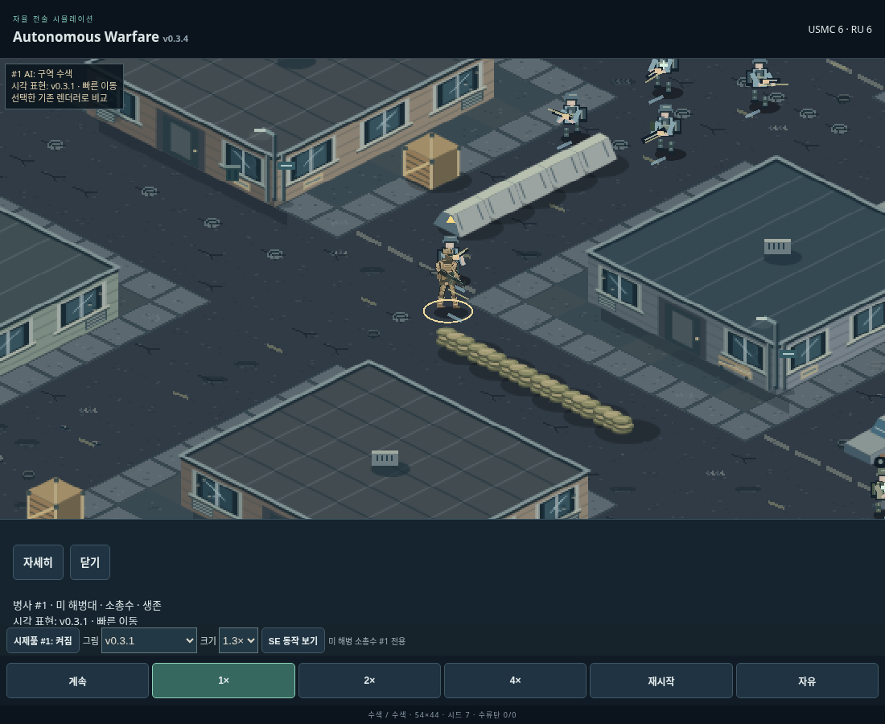
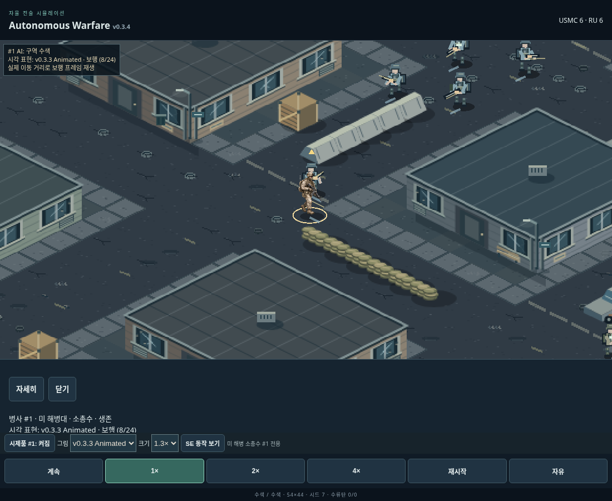

# v0.3.4 — live combat animation integration

Branch: `feat/v034-live-combat-animation`  
Baseline: merged main `e68ba18`, including corrected v0.3.3 artwork `318bbfa`.

The actual AI-controlled USMC rifleman **id 1** now uses the existing corrected
v0.3.3 full-body PNG atlas in supported SE states. It is enabled by default.
This release adds no artwork, other directions, or combat changes. The separate
SE preview is retained, but **all evidence below comes from real battles**.

## Integration and authoritative state

The missing connection was in `main.js`: the battlefield loaded/drew only
`SoldierPrototype` (v0.3.0/v0.3.1). The corrected SE atlas was used exclusively
by the standalone preview. Its demonstrated actions had no live combat adapter.

`LiveUSMCState` now reads authoritative state without writing the battle:

| Live condition | SE animation / source |
| --- | --- |
| Actual displacement with compatible travel and observation directions | Eight whole-body walking cels 4–11; phase follows interpolated traveled distance |
| Stationary, no engagement | Idle/low-ready cels 0–3 |
| Selected, active, directly visible enemy; actual Aiming/Engaging state | Raise 12–15, then shouldered aim 16 |
| Actual last-known suppression task | Raise/aim only; a real shot event is still required for recoil |
| Actual `shot` event for id 1 | Recoil 17–19; event id/time drives the cue, not a looping fire clip |
| Actual engagement ends | Lower 20–23, then idle or walking when compatible |
| Unsupported direction, posture or action | Existing stable v0.3.1 or stock presentation |

The authored raise is at most 0.64s and is shortened to the soldier's existing
aim deadline. A real shot immediately takes priority; animations never postpone
or create a shot. Lowering takes up to 0.70s, reverses from its current progress
on reacquisition, and never changes orders. At higher speeds short cels may be
skipped rather than delaying simulation. No preview demonstration clock or fake
preview firing cues are used by the battle adapter.

`LiveUSMCRenderer` uses **one image containing the whole person and rifle**.
There is no separately rotated weapon, arm, or shoulder on the new renderer.
It uses the atlas's per-cel muzzle and `(132,247)` foot anchor, uniform scale,
rotation zero, existing interpolated ground position, and battlefield depth.
Real flashes, tracers and smoke start at the drawn muzzle. Trace destinations
and all hit calculations remain unchanged. Up to eight event anchors are cached
so smoke does not jump when the renderer/direction changes. Restart clears them.

The unchanged atlas is 1024×1536 (24 256×256 cels), native standing height 201px.
Default `1.3×` = **39px before camera zoom**; controls retain 30px and 45px options.
Its decoded RGBA texture is approximately 6 MiB. It is loaded once and one image
is reused; no per-frame textures or particles were added. Diagnostic history is
bounded to 32 changes.

## Direction and fallback rules

Movement and observation remain independent in the simulation and existing
interpolator. The SE travel axis is projected ground +X (screen angle 26.565°).
The SE look/travel gate enters within 20° and exits outside 26°; this spatial
hysteresis avoids noisy boundary switching. Movement must also be within 15° of
observation. Other directions are never represented by rotating or mirroring
the SE image.

The authored shouldered barrel points approximately 10° down-right. A separate
aim gate allows 20° on entry and 22.5° on exit around that fixed barrel. It is
checked throughout aiming, not just during flashes. Thus the firing sector is
intentionally narrower than a generic SE octant. This is ordinary fixed-frame
direction quantization, **not continuously exact weapon rotation**. Larger
differences immediately fall back, preventing backward/visibly wrong firing.

Unsupported SE postures/actions: crouching/full cover, suppression posture,
limping/crawling, reloading, grenade preparation/throw, treatment, mounting,
incapacitation and death. Existing v0.3.1 handles its supported states; the stock
renderer handles its existing special actions/casualties. Moving while raising,
lowering, aiming or firing also uses the legacy renderer: the available stationary
SE firing cels cannot depict independent strafing without sliding planted feet.
After the transition ends, compatible actual movement resumes the full-body gait.
All other eleven soldiers retain their existing presentation.

## Controls and diagnostics

The prototype selector defaults to **v0.3.3 Animated**. **v0.3.1** provides a
controlled stable-renderer comparison; v0.3.0 and the prototype off switch remain.
The Korean inspector reports the **actually displayed** renderer, animation and
frame, plus the real fallback reason in its expanded view. An unsupported hidden
SE candidate is not mislabeled as the visible action.

`?debug=1` adds a pointer-transparent overlay with #1's actual AI action,
renderer, animation/frame and selection/fallback reason. It updates on a change
in the same frame as drawing. The regular inspector retains its 100ms refresh.
No new enemy coordinates are displayed; the adapter's target identity is exposed
only for the soldier's currently confirmed visible selected target.

## Actual live-combat evidence and visual review

These are unmodified expanded 6v6 seeded matches. Only spectator UI controls
(camera, selection, pause, speed and renderer selector) were used. No injected
orders, target positions, shots, teleports or animation-demo states.

| Real-battle evidence | Observed sequence |
| --- | --- |
| [Seed 7 first contact — MP4](v034-live/first-contact.mp4), 9.67s | Walking → stop/raise at 21.75s → real target/fire at 22.10s (shot id 1) → lower at 22.35s → direction fallback → SE idle |
| [Seed 32 combat and movement resumption — MP4](v034-live/contact-and-resume.mp4), 14.63s | Raise at 21.90s → real shot id 4 at 22.20s → repeated recoil/aim → suppression/turn fallback → SE walking at 33.00s during actual contact reacquisition |
| [Seed 31 full lowering — MP4](v034-live/complete-lower.mp4), 2.47s | Actual engagement loss → all four lowering cels 20–23 → idle |

Layouts are `seed % 4`; spawn configurations are `floor(seed / 4) % 3`:
7 = layout 3/spawn 1, 32 = layout 0/spawn 2, 31 = layout 3/spawn 1.
The videos run at 1×, with camera zoom approximately 1.95× and default 39px base
height. Encoding samples actual captured browser frames at 30fps; it generates
no pose in-betweens. Frame-by-frame review included all eight walking cels,
all four raising cels, recoil/recovery 17–19, and all four lowering cels.

Exact phase screenshots pause the real match at an observed supported state,
wait for browser composition, and verify renderer/frame before saving:
[Walking](v034-live/live-walking.png) · [Raise](v034-live/live-raising.png) ·
[Aim](v034-live/live-aiming.png) · [Real shot/recoil](v034-live/live-firing.png) ·
[Lower](v034-live/live-lowering.png).

Fair before/after: same paused seed 7 at **21.20s**, same camera, selection,
39px base size and combat state. Only the selector changes:

| v0.3.1 live renderer | v0.3.3 Animated live renderer |
| --- | --- |
|  |  |

Visual review confirmed whole-body stepping, connected hands/rifle/shoulders,
ground anchoring and barrel-aligned flashes/traces in the new renderer. It also
confirmed the art-style pop during legitimate renderer changes; this is retained
as a documented limitation rather than rotating SE artwork or changing AI facing.
Nearby teammates can overlap visually in projection; their positions/collisions
were not changed. Fine cloth/gear variation and imperfect foot weight transfer
are inherited from the existing atlas, not newly authored animation quality.

## Validation

- `npm install --offline --ignore-scripts`: succeeded with existing cached dependencies; no dependency additions.
- Final `npm test`: **274 passed, 0 failed** (258 existing + 16 new grouped tests).
- `npm run build`: succeeded. Existing large Phaser/common-chunk warning remains.
- `node scripts/check-v034-parity.mjs /tmp/aw-v034-base`: **40 matched pairs / 80 complete executions**, identical per-tick SHA-256 digests against main `e68ba18`.
- `node scripts/verify-v034-evidence.mjs`: verified the actual recording states, shot timestamps, eight gait/four lowering cels, post-combat walking, source hashes, test totals and browser results.
- `git diff --check`, script syntax and shell syntax checks: passed.

The new tests cover actual-target acquisition, event-only recoil, reaction/aim
deadlines, interruption by real shots, engagement loss, movement resumption,
pause/restart, bounded history, immutable observations, SE hysteresis, independent
travel/aim, fixed-barrel rejection, special-state fallback, one-image 39px scaling,
real muzzle/trace origins with unchanged endpoints, asset failure, actual rendered
inspector status, and real autonomous seeded 6v6 sequences (7 and 32).

| Replay cohort | Seeds / configs | Complete baseline + updated executions | Divergences |
| --- | --- | --- | --- |
| Legacy | 2001–2020; variant `(seed-2001)%4`, original spawn | 20 + 20 | 0 |
| Expanded | 2001–2020; same variants; spawn `floor((seed-2001)/16)%3`; grenades on | 20 + 20 | 0 |

Every simulation tick hashes RNG state, outcome/time, individual body-part health,
ammo/reserve, movement/facing, AI state, suppression, assignments, posture/mount,
medical treatment, routes/navigation, progress/diagnostics/activity, squad goals,
maneuvers/search and grenade statistics. Rendering, selector/scale changes,
inspection, effects and interpolation are exercised on the updated side.
Durations and outcomes match exactly: legacy 38.95–196.85s, expanded 61.50–186.40s.
There were no paired-run timeouts. This is a presentation parity check, not an AI
performance improvement claim.

All **36 existing JavaScript modules other than the rendering entry point and
trace renderer are byte-identical** to baseline, including simulation, AI,
world/pathfinding, injuries, cover, medics, grenades and animation interpolation.
The corrected PNG and metadata hashes also match baseline exactly. The only
trace change is a presentation start-point override; its target endpoint is
unchanged. [Replay hashes](v034-parity.json) ·
[Validation summary / source hashes](v034-live/validation.json).

An additional **80 complete exploratory matches**, seeds 1–80, used default
expanded variants/spawns and grenades to locate naturally occurring sequences.
All completed within the 300s discovery cap. They are not paired regression or
performance results. Exact decisions and seeds:
[1–24](v034-discovery.json), [25–80](v034-discovery-extended.json).

## Mobile checks and remaining limits

Actual production build tested in Chromium 155, 390×844 portrait and 844×390
landscape with touch emulation. Verified #1 selection including enlarged helmet,
30/39/45px controls, all renderer options, Korean inspector details/native scroll
and close, pinch/drag, preview open/close preserving pause, pause stability,
1×/2×/4× progress, and five restarts clearing old selection/shot state and static
cache keys. No page errors or failed requests.

Final five-second 4× sample: 300 RAF intervals, P50 **16.7ms**, P95 **16.8ms**,
max **33.2ms**. This is cloud desktop Chromium with mobile viewport/touch
emulation, not an iPhone hardware benchmark or a long-duration memory profile.
[Mobile inspection screenshot](v034-live/mobile-inspector.png) ·
[Mobile battlefield](v034-live/mobile-game.png) · [Browser results](v034-live/mobile.json).

Remaining limitations:

- SE is the only new direction; selection may frequently fall back as the AI
  legitimately scans, changes posture, or aims elsewhere. Hysteresis reduces
  boundary jitter, but cannot blend different artwork styles without ghosting.
- The fixed SE barrel has finite angular error; exact continuous aiming and
  moving-while-shouldered need additional authored full-body directions/poses.
- Real fire/reactions can interrupt a raise/lower before every cel is shown;
  gameplay timing takes priority. No separate full-body run/reload/crouch atlas
  was invented. The existing gait speeds up with actual movement distance.
- Existing atlas joint/kit/foot-contact imperfections remain. This integration
  does not certify the artwork as a finished realistic animation set.
- **Physical iPhone Safari remains unverified.**

## Reproduction and physical Safari checklist

1. Check out this branch, `npm install`, `npm run build`, then `npm run preview -- --port 4234`. Open the reachable host URL with `/annous-warfare/?seed=7&debug=1`.
2. Leave **v0.3.3 Animated**, 1.3×, 1× speed. Observe #1's whole-body walk and initial contact near 22s. Compare v0.3.1 while paused at the same SE pose.
3. Run seed 32 (its default layout/spawn): check supported recoil/aim, legitimate fallback and new gait resumption near 33s. Seed 31 shows full lowering near 31.8s.
4. Tap #1's head/body at each scale; check actual renderer/frame and Korean reasons, scrolling and close. Select other soldiers to verify unchanged behavior.
5. Pan/pinch, rotate portrait/landscape, test 1×/2×/4×, pause/resume, restart during recoil/raising and open/close the standalone preview. Watch for old shots, detached flashes, sprite sliding or camera/selection changes.
6. Test a full battle and thermal/frame stability on the physical phone; especially watch renderer changes during cover, suppression, injury and direction changes. Do not treat the separate preview as live-combat proof.

For automated evidence, install/provide Playwright and Chromium/FFmpeg, run the
production server at port 4234, then `bash scripts/evidence-v034.sh`. Set
`AW_PLAYWRIGHT_MODULE` if Playwright is outside the project. To reproduce parity,
archive `src`, `package.json` and the SE asset directory from `e68ba18` into
`/tmp/aw-v034-base`, then run the parity script above. The evidence verifier also
reads the full test log from `/tmp/aw-v034-tests-final.log`.

## Files and delivery

- New live adapter/render/inspection: `src/live-usmc-state.js`, `src/live-usmc-renderer.js`, `src/live-usmc-inspection.js`.
- Integration and UI: `src/main.js`, `src/combat-visuals.js`, `src/style.css`, `index.html`.
- Tests and version: `test/live-usmc.test.js`, `package.json`, `package-lock.json`.
- Documentation: `README.md`, `public/assets/usmc-se-v033/README.md`, this report.
- Reproducible QA: `scripts/check-v034-parity.mjs`, `scripts/find-v034-battles.mjs`, `scripts/capture-v034-live.mjs`, `scripts/mobile-v034.mjs`, `scripts/verify-v034-evidence.mjs`, `scripts/evidence-v034.sh`.
- Evidence: `reports/v034-parity.json`, `reports/v034-discovery*.json`, `reports/v034-live/` PNGs, MP4s and JSON records.

Integration checkpoint: `21fe53e`. Subsequent commits contain live visual QA,
the synchronized debug-label fix, real-match regressions, and delivery evidence.
Comparison: https://github.com/dydtjs345-ux/annous-warfare/compare/main...feat/v034-live-combat-animation

No merge or main/Pages deployment is performed by this work.
