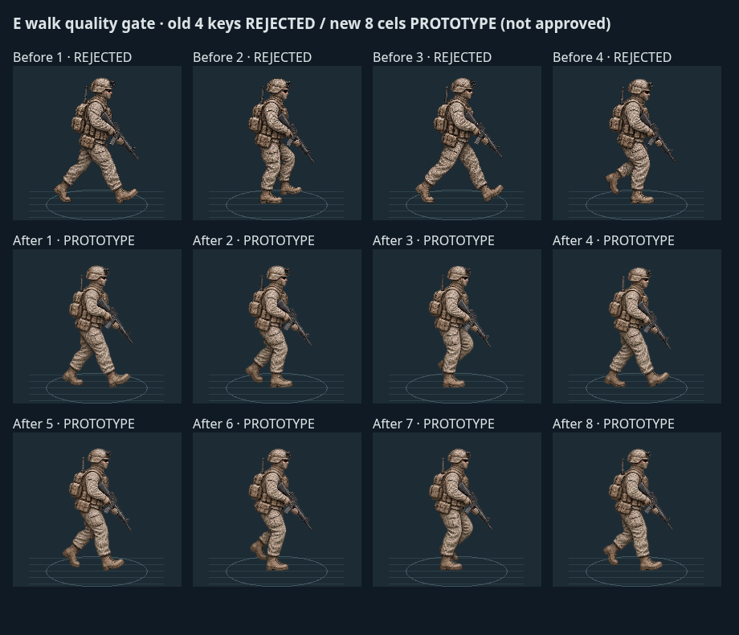
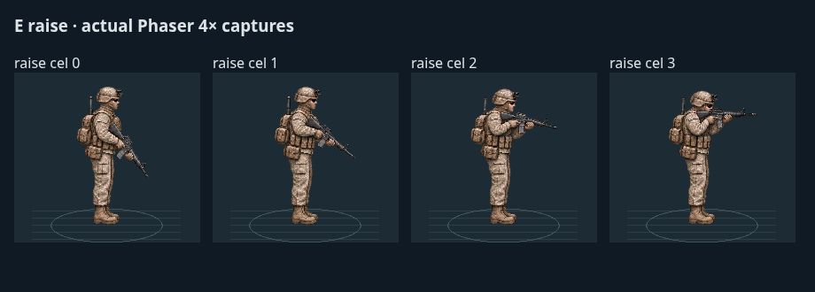
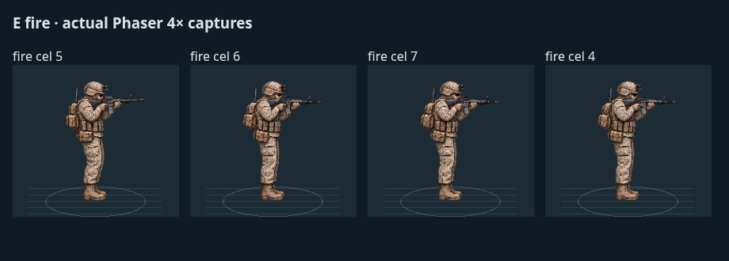

# v0.3.5 — E-direction animation production continuation

This is a **partial artwork delivery**, resumed on the existing `feat/v035-rifleman-animation-foundation` branch. Seven E standing/weapon-handling clips now have usable, reviewed full-body artwork: **16 newly approved unique cels**. E walking remains **PROTOTYPE**. E is not a completed direction, and the six remaining missing directions were not expanded past this quality gate.

At the start, a fetch and fast-forward check confirmed that local HEAD and the pushed branch both pointed to `819867f063914302c483446cbcab23dc0356c513`. No assumed checkpoint, restart from main, discarded changes, forced push or automatic merge was used. The [previous foundation report](v035-rifleman-animation-foundation.md) and its evidence remain historical records.

## Artwork delivered and reviewed

| New PNG bank                | Authored cels | Newly approved unique cels | Use                                                                     |
| --------------------------- | ------------: | -------------------------: | ----------------------------------------------------------------------- |
| `production/e-quiet.png`    |             8 |                          8 | Four subtle low-ready breathing poses; four high-ready poses            |
| `production/e-handling.png` |             8 |                          8 | Four rifle-raise poses, settled aim, recoil peak and two recovery poses |
| `production/e-walk-v2.png`  |             8 |                          0 | New gait review candidate; PROTOTYPE only                               |
| **Total**                   |        **24** |                     **16** | **Seven approved clips; no completed new direction**                    |

Lowering reuses the four authored raising cels in reverse. Low-ready shares the first breathing cel, and the recoil loop returns to the existing aimed cel. These reuses are **not** counted as additional new artwork. The existing 24 SE cels, four old static E poses and four rejected E walk keys are also excluded from the new-frame count.

These are original, model-assisted transparent PNG cels, not crops of the concept sheet, rotated SE copies, mirrored equipment or a rotating weapon over a static body. Every cel contains the complete equipped person, both arms/hands and rifle. The new masters use a 4×2 grid of 384×512 cells and a common native standing scale of 459 pixels. At the normal 1.3× control value the standing height is 39px; the lab compares the same art at 39px and 4×. Bent/shouldered poses retain their authored height rather than being stretched back to a fixed bounding box.

The final quiet/handling banks have a clear alpha background. One early handling export had a translucent pale matte and was not used. Source hashes, measured bounds, foot anchors and muzzle points are in the adjacent JSON files. No pixel warping or whole-character vertical stretching was used to repair registration.

### What passed visual review

- Breathing is restrained: small shoulder/upper-body variation while both boots remain planted. Low-ready is a held stance from that set.
- High-ready holds the rifle with both hands; shoulders and elbows remain part of the full-body drawing. Its transition from low-ready is **not** authored, so it remains a separate laboratory clip rather than a fabricated blend.
- Raising moves the hands, forearms, shoulders and rifle together into a shouldered pose. The pack/pouches remain attached to the torso.
- Aiming retains a planted, shouldered silhouette. Firing uses a small coordinated rifle/arm/shoulder recoil and return, without a detached gun object.
- Lowering follows the same drawn raising path in reverse. It is a usable first pass, not newly authored intermediate physics or a claim of perfect motion capture.

All 16 approved cels and eight new gait cels were inspected individually in the actual Phaser renderer and in continuous recorded playback, at both gameplay and magnified size. Technical tests did not decide art approval. Fine camouflage flicker, receiver/stock detail and subtle equipment consistency can still benefit from dedicated pixel-artist cleanup; historical equipment accuracy is not certified.

## E walking: diagnosed and still not approved

The old rejected four-key walk has too few in-between poses, long stride gaps, uneven sole placement and inconsistent leg/kit continuity. Its front-facing-leg pattern is not an acceptable complete alternating gait. The archive remains accessible through `rifleman-lab.html?review=e-walk-keys`, explicitly labeled **REJECTED**, with no live capability admission.

The new eight-cel candidate adds passing/weight-bearing poses and individual sole registration, but visual inspection still shows:

1. A repeated leading-leg pattern rather than an unambiguous left/right alternation, especially around cels 2→3 and 6→7.
2. Passing knees/feet lifted too high for the intended relaxed tactical stride.
3. No validated stance-foot travel curve to prevent skating during actual translation.
4. No approved idle→walk and walk→idle connection cels.

A further targeted gait correction and a start/stop authoring attempt did not reliably solve leg identity/contact continuity. They were not promoted or counted. Reordering frames or adding long pose holds would mask the missing anatomy rather than fix it. The current image-authoring method can produce useful stance/handling drawings, but has not reliably produced this phase-consistent alternating gait. It needs a pose-controlled artist pass: preserve the near-leg pouch/knee identity, draw both contact/passing halves explicitly, then verify the planted-foot trajectory against distance-paced movement and author start/stop transitions.

**No E walking approval and no S→SW→W→NW→N→NE expansion is claimed.** The new gait is visible for debugging, marked PROTOTYPE, and cannot enter live combat.

## Confirmed registration defect corrected

An apparent rifle-length change in the handling sheet was investigated before being treated as an anatomy problem. The whole figure—including the boots—had shifted horizontally by 32 native pixels in cels 2, 3, 6 and 7. A common cell-center anchor therefore made the body and barrel jump.

Individual boot-midpoint/sole anchors now register each cel. Registered aimed muzzle offsets differ by less than two native pixels across the settled aim/recovery cels. This corrects atlas packing without changing rifle length, limb shape, simulation position or anatomy. A passing-foot/ground-contact curve is a separate issue; registering the walk's bounding box does not constitute gait approval.

## Explicit completion matrix

**COMPLETE** means this particular clip passed the present 39px/4× connected-body review. It does not mean that the whole direction, every possible transition, independent upper/lower-body pairing or reference-perfect equipment art is complete. Existing SE animation-foundation prototype labels are preserved; the approved SE proportions/art reference and original assets are unchanged.

| Direction | Idle breathing | Low-ready | High-ready | Raise     | Aim       | Lower     | Walk      | Fire/recoil |
| --------- | -------------- | --------- | ---------- | --------- | --------- | --------- | --------- | ----------- |
| N         | MISSING        | MISSING   | MISSING    | MISSING   | MISSING   | MISSING   | MISSING   | MISSING     |
| NE        | MISSING        | MISSING   | MISSING    | MISSING   | MISSING   | MISSING   | MISSING   | MISSING     |
| E         | COMPLETE       | COMPLETE  | COMPLETE   | COMPLETE  | COMPLETE  | COMPLETE  | PROTOTYPE | COMPLETE    |
| SE        | PROTOTYPE      | PROTOTYPE | MISSING    | PROTOTYPE | PROTOTYPE | PROTOTYPE | PROTOTYPE | PROTOTYPE   |
| S         | MISSING        | MISSING   | MISSING    | MISSING   | MISSING   | MISSING   | MISSING   | MISSING     |
| SW        | MISSING        | MISSING   | MISSING    | MISSING   | MISSING   | MISSING   | MISSING   | MISSING     |
| W         | MISSING        | MISSING   | MISSING    | MISSING   | MISSING   | MISSING   | MISSING   | MISSING     |
| NW        | MISSING        | MISSING   | MISSING    | MISSING   | MISSING   | MISSING   | MISSING   | MISSING     |

Current best-available inventory: **7 COMPLETE, 8 PROTOTYPE, 49 MISSING** (64 cells). The archived old E four-key walk is separately **REJECTED**, not relabeled by the existence of a newer prototype. Existing four static E prototypes are preserved separately. Completed new directional sets: **0**.

## Live integration and laboratory

The existing default **v0.3.3 Animated** mode remains intact. Select **그림 → v0.3.5 E + SE Animated** to opt into the new E art for USMC rifleman #1. Other soldiers are unchanged.

- Authored E uses a narrow screen-space sector: enter within 6°, remain within 10°. Aiming has the same narrow barrel gate. Neither E nor SE is rotated/mirrored to cover missing directions.
- The read-only E adapter consumes actual movement, target/direct-contact eligibility, aiming deadline and shot events. It reuses the preserved SE presentation transition controller with separate art/timing parameters; no combat deadline is changed.
- Idle, raise, aim, recoil and lower map to approved E cels. A shot can immediately override an unfinished raise; animation never delays an actual shot.
- Recoil/flash in battle requires a real shot ID. The lab recoil loop is explicitly a demonstration. An old event cannot loop back into a second recoil animation.
- Moving E uses stable fallback because its new gait has not passed. Moving combat, injury, suppression, cover, reload, medical, grenade and casualty poses also retain stable fallback. Unsupported orientations retain the existing SE/legacy path as appropriate.
- High-ready is available in the lab/foundation; the live adapter does not invent a high-ready simulation state.
- Each new drawing is one complete person with integrated weapon. Independent movement/aim directions remain authoritative; unpainted combinations fall back instead of turning the whole sprite.
- Muzzle flashes and traces originate at the currently drawn cel's registered muzzle. Receiver/casing origins are approximate art annotations; they do not affect projectile endpoints or damage.
- The inspector/debug overlay reports the actual drawn renderer, action and correct bank frame count, including why unapproved E movement fell back.

The lab now supports all eight requested action selectors including recoil, per-clip banks, 39px/4× comparison against unchanged SE, frame stepping, pause, slow motion, scrub and explicit English/Korean COMPLETE/PROTOTYPE/MISSING labels. The old rejected walk remains a locked, watermarked review. The E demonstration includes its unapproved gait and labels that stage PROTOTYPE; it is not advertised as a completed continuous walk/stop set. High-ready remains separately selectable because its connection is missing.

## Actual screenshots and recordings

These are captures of the production Phaser app, not re-rendered concept art or synthetic combat:

- [Full-body E playback MP4, 15.92s](v035-production/E-full-body-playback.mp4): breathing, high-ready, raising, aim, recoil, lowering, then the explicitly unapproved walk candidate.
- [Actual autonomous battle MP4, 9.20s](v035-production/live-E-combat.mp4): seed 9, expanded variant 1/spawn 2, normal spectator camera/controls. Recorded battle time 50.45–59.05s at 1×; E raising, aiming and actual firing are visible. Shot IDs 187 and 195 drive E recoil. The window does not demonstrate every possible E state; lowering/quiet poses are shown in the lab and covered by state-transition tests.
- [Same frozen tick, old live renderer](v035-production/live-E-legacy-before.png) / [new E full-body live renderer](v035-production/live-E-firing-after.png), battle time 52.35s. Only the renderer selector changed.
- [E aiming at 39px/4× with SE reference](v035-production/lab-E-aim.png), [raising](v035-production/lab-E-raise.png), [recoil](v035-production/lab-E-fire.png), [lowering](v035-production/lab-E-lower.png), [quiet stance](v035-production/lab-E-idle.png), [high-ready](v035-production/lab-E-highReady.png).
- [Mobile live E shot and Korean inspector](v035-production/mobile/mobile-live-E.png), [mobile laboratory](v035-production/mobile/mobile-in-game-lab.png), [mobile high-ready / full completion table](v035-production/mobile/mobile-E-highReady.png).
- [Every rendered cel and capture data](v035-production/visual-evidence.json), [real-battle frame/state samples](v035-production/live-playback.jsonl), [art decisions and approval scope](v035-production/art-decisions.json).

Both final MP4s were decoded for visual checks. Every authored cel was reviewed in the individual pose galleries; representative recorded frames were also inspected. The live barrel/flash/trace alignment and full-body shoulder response are visible. No approved E walk or six additional directions can be inferred from these recordings.

## Tests, build and deterministic verification

- **303/303 automated tests passed**, zero failed/cancelled/skipped. Existing suite plus 13 new production-art/live-adapter tests. [Full test log](v035-production/tests.log).
- Foundation tests were updated for the actual authored per-clip banks and matrix rather than keeping the obsolete assertion that E had only four static poses. Existing SE gait timing, rejected-art isolation, missing-view handling, turn/pair guards and no-RNG-mutation tests remain.
- New tests cover distinct approved-frame counting, measured registrations, per-action stepping, preserved SE timeline, real target raise/lower, real-shot-only recoil/no replay, unapproved-walk fallback, directional hysteresis, special/casualty fallback, uniform one-image rendering/muzzle attachment, Pages-safe preload, actual renderer inspection and paused/read-only/restart behavior.
- **Production build passed**. [Build log](v035-production/build.log). Vite still reports the existing large Phaser bundle advisory; no new dependency was added.
- **40/40 deterministic pairs matched, 80 complete executions**, comparing checked checkpoint `819867f` with this implementation. Seeds **2001–2020** in both legacy and expanded mode, fixed `dt=0.05`, `variant=(seed-2001)%4`, `spawn=floor((seed-2001)/16)%3`, grenades enabled for expanded mode. Every run reached the existing outcome; zero parity timeouts.
- The candidate runs exercise actual presentation drawing, E/SE and legacy switching, lab/rig observation and inspection. Tick hashes include RNG state, outcomes/time, positions, active/dead states, body-part health, ammunition, suppression, assignments, cover posture, mounting, treatment, routes/navigation/progress, diagnostics/activity, grenade state/events and squad objectives. [Exact seeds, durations and hashes](v035-production/v035-production-parity.json).
- **40 existing source modules** outside the intentional presentation changes are byte-identical to the checked checkpoint, including all simulation/AI/navigation/medical/weapon systems. All **8 existing SE/foundation asset files** are preserved byte-for-byte. [Verification manifest](v035-production/verification.json).

For context, durations below are identical in both sides of the matched replay check; this is not an AI performance improvement claim. Percentiles use nearest rank, median uses the midpoint of the central values.

| Cohort   | Pairs | P50 baseline / final | P90 baseline / final | P95 baseline / final | Max baseline / final | Timeouts |
| -------- | ----: | -------------------: | -------------------: | -------------------: | -------------------: | -------: |
| Legacy   |    20 |       70.55 / 70.55s |       96.50 / 96.50s |     162.10 / 162.10s |     196.85 / 196.85s |    0 / 0 |
| Expanded |    20 |       92.30 / 92.30s |     152.30 / 152.30s |     159.95 / 159.95s |     186.40 / 186.40s |    0 / 0 |

### Mobile/browser results

Mobile Chromium at 390×844 and 844×390 passed actual UI checks: native iframe touch scrolling, direction/action selectors, frame step, all display sizes, accurate quality labels, modal pause isolation and cleanup, missing-art blank views, portrait/landscape and unchanged 1×/2×/4× controls. The real E shot was also checked on mobile; upper-body touch selection passed at 30/39/45px, Korean renderer diagnostics matched, pause held the tick and restart cleared selection/shot state.

The preserved live-combat browser check additionally passed camera pinch/pan, SE head selection, legacy comparisons, inspector scrolling, five restarts and static-cache cleanup. Browser logs recorded zero page errors and zero failed requests in both checks.

The five-second laboratory 4× sample had 300 intervals, P50/P95 **16.7/16.7ms**, max **16.8ms**. The live compatibility sample had 291 intervals, P50/P95 **16.7/16.8ms**, max **116.6ms**: one hitch remains in that desktop emulation run. These are Linux Chromium measurements, not iPhone hardware benchmarks or evidence of a rendering speedup. [Lab/mobile results](v035-production/mobile/mobile.json), [preserved live checks](v035-production/mobile-live/mobile.json).

Battle loading adds two cached E 1536×1024 RGBA masters (about **12MiB decoded**, excluding GPU copies). The prototype walk is loaded only by the laboratory. There is still one full-body image per active renderer and no per-frame texture generation, pathfinding, particle work or simulation RNG added. Hardware memory/battery/Safari performance is unverified.

## Remaining artwork and interaction limitations

- E walking and start/stop are unfinished; the new gait cannot be approved from test counts. The full eight-direction objective is not satisfied.
- S, SW, W, NW, N and NE need genuinely authored equipment-aware views, not rotations/mirrors. Expansion remains gated behind the E walk fix.
- No new independent upper/lower-body pair, direction-turn bridge, high-ready transition or moving-aim animation is claimed. The foundation retains these capability checks and stable fallback.
- E/SE/legacy switches can still be visibly different in silhouette/style, particularly near the sector edge or when a soldier begins moving. Hysteresis limits boundary flicker, but no missing turn cel or blend is fabricated. Use the explicit renderer selector for controlled comparison.
- Fine texture/kit continuity, ideal breathing anatomy and receiver/stock authenticity still need an artist pass. COMPLETE labels describe the reviewed clip's usable animation scope, not final AAA/reference-sheet equivalence.
- Physical iPhone Safari has **not** been tested.

## Physical iPhone Safari checklist

1. Open the feature build through `npm run dev -- --host 0.0.0.0` on a reachable host, or a separately configured preview. Pushing this feature branch does not deploy main's Pages site.
2. Open **8방향 연구실**. Select E, 39px; review all seven COMPLETE clips at 1×, 0.25× and frame-step, then 4× magnification. Verify planted boots, matching head size, supported rifle/shoulder alignment and no light background matte.
3. Inspect the PROTOTYPE eight-cel walk and the REJECTED four-key review separately. Confirm their labels and that neither is advertised as an approved E walk.
4. In a real battle select **v0.3.5 E + SE Animated**. Watch #1 acquire/fire in E, begin moving into fallback, turn into SE/other directions and return. Confirm no fake shots, floating hands, hidden covered body, or stale recoil after pause/restart.
5. Tap #1's upper body at all three scales; scroll/close the Korean inspector. Pan/pinch before and after opening the lab. Rotate portrait/landscape and close/reopen repeatedly.
6. Compare with v0.3.1 and default v0.3.3. Test 1×/2×/4×, pause/resume and repeated restarts; watch for memory pressure, thermal throttling and the desktop-observed occasional frame hitch.

## Files, reproducibility and delivery

- Artwork: three new PNGs and measured JSON metadata under `public/assets/rifleman-foundation-v035/production/`; original SE/static E/rejected E files unchanged.
- Lab/foundation: `src/rifleman/catalog.js`, `clock.js`, `lab.js`, `rifleman-lab.html`.
- Live presentation: `src/rifleman/live-east-state.js`, `live-east-renderer.js`, `src/live-usmc-state.js`, `live-usmc-renderer.js`, `live-usmc-inspection.js`, `src/main.js`, `index.html`.
- Validation: `test/rifleman-foundation.test.js`, `test/rifleman-production.test.js`, `package.json`; `scripts/check-v035-production-parity.mjs`, `mobile-v035-production.mjs`, `capture-v035-production.mjs`; reports and README.
- Milestone **`aea3866`**: author/review E stance and handling art; retain explicit walk quality gate.
- Milestone **`dd900bf`**: opt-in real-combat E integration, 13 new tests, matched replay and mobile compatibility evidence.
- Final evidence/report checkpoint: see the branch's last commit and delivery response. The earlier foundation commits remain in history.

Reproduce with `npm test`, `npm run build`, then a production preview on port 4236. Browser scripts accept `AW_GAME_URL`, `AW_PLAYWRIGHT_MODULE` and `AW_REPORT_DIR`. Video capture requires Playwright's ffmpeg installation (or configured equivalent) and system ffmpeg. The paired replay script takes an archived baseline directory as its first argument; archive the checked `819867f` source/package/assets before running it. Historical v035 reports/scripts are preserved rather than rewritten as if they described these new assets.

Branch: **`feat/v035-rifleman-animation-foundation`**. [GitHub comparison against main](https://github.com/dydtjs345-ux/annous-warfare/compare/main...feat/v035-rifleman-animation-foundation). No automatic merge.
