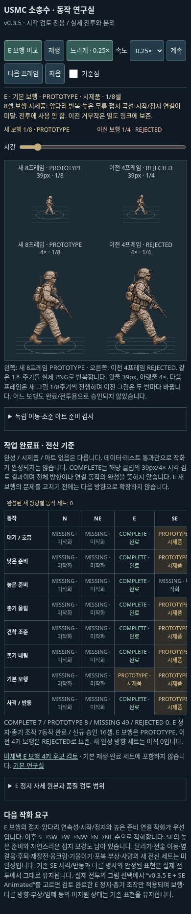

# v0.3.5 — interactive mobile E-walk review

The feature branch now includes an interactive old/new walk comparison **inside the existing animation laboratory**. A separate public mirror of that comparison is available without merging main, downloading an MP4, signing in or running a development server.

## Public preview — verified

Open this ordinary web URL directly in Safari:

https://cdn.jsdelivr.net/gh/dydtjs345-ux/annous-warfare@1c1b8c62b6dad9617f6a3a6fee2dc488c36c4a14/previews/v035-e-walk.svg

This is a **standalone interactive SVG document**, not a video or a full battle deployment. It uses the same comparison controller, original PNG frames and layout as the in-game pane. Open the link as a full browser page; embedding an SVG with an image tag or viewing it in a static image viewer disables scripts. If an app displays it as a still image, use **Open in Safari**.

Publication was checked at the exact pinned URL:

- HTTPS GET: **HTTP 200**.
- MIME type: **`image/svg+xml`**, served as a browser document.
- CDN version header: commit `1c1b8c62b6dad9617f6a3a6fee2dc488c36c4a14`.
- Download SHA-256 equals the checked-in file: **`fd775dbf191b90832c3132b9db00e5a647d7c280300abbb0e53569151b9d5e7f`**.
- The exact external URL was opened in mobile Chromium through the managed HTTPS proxy with certificate verification intact. Actual frames, controls and sizing were exercised there, rather than testing only a local copy or an HTTP status.

[Public-URL browser checks](v035-walk-preview/public/browser-check.json) and [public mobile screenshot](v035-walk-preview/public/mobile-public-svg.png).

## GitHub Pages limitation

The existing `.github/workflows/deploy.yml` publishes one production Pages site from main (or its manual dispatch). It has no isolated branch-preview destination. Dispatching that unchanged workflow against this feature branch would replace the production site's artifact, so it was not used for this request.

The current cloud network policy also blocks both `api.github.com` and `dydtjs345-ux.github.io`. The Pages configuration API returned `Forbidden`; the Pages hostname failed at the proxy's HTTPS CONNECT with 403. This does **not** establish that repository-level Pages permissions are absent—we cannot inspect them through the current policy.

An optional environment-settings draft preserves the existing API-domain request and adds the specific Pages hostname. It is saved but **not applied** (`requires_publish: true`). No settings change is needed for the working public CDN preview above. There was no Pages deployment, production-site replacement, new hosting account, token request or merge into main.

The alternative is isolated by immutable feature commit and path. It serves only the review document from the existing public GitHub repository through jsDelivr. It is independent of a cloud process, localhost address, session port or temporary tunnel.

## In-game laboratory

On a feature-branch game build:

1. Tap **8방향 연구실**.
2. Tap **E 보행 비교**.
3. Use **재생**, **일시정지 / 계속**, **느리게 · 0.25×**, **다음 프레임**, **속도** and **처음**. The existing time scrubber also works.

A feature host may open `rifleman-lab.html?compare=e-walk` directly. The comparison button updates that query parameter for sharing and restores the previous normal laboratory clock when comparison is turned off.

The pane uses two columns at phone sizes instead of stacking the magnified soldiers. Both versions have an actual **39px standing reference scale** and **4×** view. Existing bent poses keep their natural height; neither atlas is stretched to equalize each frame's bounding box. Individual source foot anchors remain intact.

- Left: **new eight-frame E walking PROTOTYPE**.
- Right: **old four-frame E walking REJECTED**.
- One shared one-second cycle synchronizes the two original clips.
- One frame step advances one eighth of the common cycle. The old clip changes every second step: `0/0, 1/0, 2/1, 3/1, 4/2, 5/2, 6/3, 7/3` (new/old frame IDs).
- Both counters and statuses are visible above/on the views. Pausing freezes the phase; speed changes preserve it. The old rejected art remains renderable only in its explicit review/comparison contexts.

**Neither gait is marked COMPLETE or admitted to combat.** The new gait still needs coherent alternating leg identity, ground-contact/weight-transfer cleanup and idle/walk transitions. This update makes that work inspectable; it does not claim to repair the artwork.

## Implementation and fixes

- `WalkComparisonClock` is a pure presentation adapter shared by Phaser and the public mirror. It samples the existing frame inventories; it never imports Battle, consumes simulation RNG or changes a unit state.
- The existing laboratory receives a comparison toggle, dedicated play/slow controls, two visible counters and a narrow-screen side-by-side layout. Normal direction/action controls, SE comparison, original rejected-art review and the rest of the lab are preserved.
- The public mirror embeds the **exact original bytes of two PNG atlases**, once each, and bundles the same controller in one approximately 4.48MB SVG. Four viewport instances share the two sources; it has no external script, video or asset dependencies after the initial document request.
- Public document sizing accounts for mobile SVG's possible 980px layout viewport. It uses the visual viewport scale rather than `screen.width`, which can remain in portrait coordinates on iOS after rotation. Native 39px/4× sizing was checked with fixed portrait screen metadata and both viewport orientations.
- A confirmed normal-laboratory rotation defect was fixed: `setParentSize()` could synchronously reenter layout, after which the outer call overwrote the fresh positions with stale portrait coordinates. Returning through a fresh layout prevents a wide 818×436 canvas from retaining the old stacked lower soldier at y=630. The original failing orientation check passed after correction.
- No soldier images, metadata, combat renderer, AI, navigation, medical, timing, balance or map files were changed. [Preservation manifest](v035-walk-preview/preservation.json): **78 protected files unchanged**, including **31 asset files**, relative to checked starting checkpoint `733ffe1`.

## Validation

- **308/308 automated tests passed**, zero failed/cancelled/skipped. [Full log](v035-walk-preview/tests.txt). Five new tests cover common-cycle frame order, pause/speed/step semantics, quality-admission isolation, all source frames fitting the phone columns and exact original PNG embedding.
- **Production build passed**, with the existing Phaser large-chunk advisory. [Build log](v035-walk-preview/build.txt). `npm run build:walk-preview` also passed.
- Production Phaser comparison checked at **320×740, 390×844 and 844×390** with touch input: play/pause, slow motion, exact stepping, normal-lab restoration, four visible unrotated/unmirrored views and no horizontal clipping.
- The public document was checked at the verified external URL: play/pause, 0.25× slow motion, frame stepping, every speed button (0.25/0.5/1/2/4×), original frame identities/statuses and actual viewport transforms at the three sizes above.
- Existing in-game mobile checks passed: modal pause isolation, native iframe scroll, SE preview, lab reopen/cleanup, normal E/SE clips, live E shot, 30/39/45px touch selection, Korean diagnostics, restart and 1×/2×/4× playback. [Compatibility results](v035-walk-preview/compatibility/mobile.json).
- The desktop-emulated five-second lab sample had 298 intervals, P50/P95 about **16.7/16.8ms**, maximum **50.1ms**. This is not an iPhone hardware benchmark or an improvement claim.
- **Physical iPhone Safari is unverified.** The document uses standard SVG/DOM/animation APIs; the managed environment has Chromium, not a usable WebKit browser. No Safari test is claimed from Chromium emulation.

## Reproduction and physical iPhone check

`npm test`, `npm run build` and `npm run build:walk-preview` reproduce the checks/builds. `scripts/check-walk-preview.mjs` accepts `AW_GAME_URL`, `AW_SVG_URL`, `AW_REPORT_DIR`, `AW_PLAYWRIGHT_MODULE` and opt-in `AW_USE_PROXY`. It checks the actual public response type and interactive document when `AW_SVG_URL` is supplied. The source/artifact build has no new package dependency.

On iPhone: open the public link in Safari, tap Pause, Step eight times and verify both counters. Try 0.25×, 1× and 4×; rotate the phone and compare the 39px/4× views. Return to Safari after backgrounding it, then verify Play/Pause again. If the Codex/app viewer treats the link as a static image, open the regular URL directly in Safari rather than an attachment/image preview. Report any WebKit-specific behavior separately from the still-unapproved gait's artistic defects.

Branch: `feat/v035-rifleman-animation-foundation`. Implementation checkpoint `4d191fa`; orientation/public-check checkpoint `1c1b8c6`. Existing work and assets remain intact. [Comparison against main](https://github.com/dydtjs345-ux/annous-warfare/compare/main...feat/v035-rifleman-animation-foundation). No merge.
